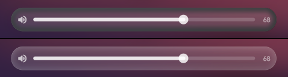
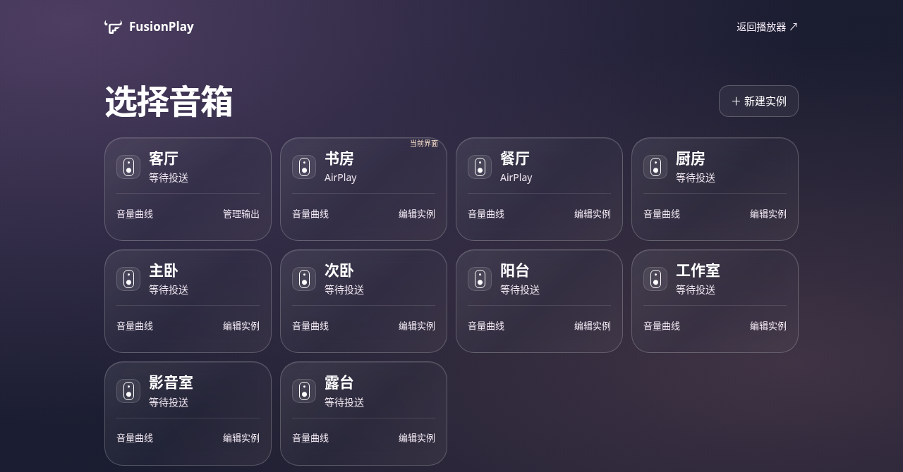

# FusionPlay fnOS 版：构建与测试验证记录

> 本文件只记录**实际执行过**的验证及结果；未执行的（真机 iPhone/DLNA 控制端/HyperOS 妙播/多声卡听感）
> 单独列在"未验证项"，绝不以推断代替结论。
> 环境：fnOS NAS（Intel N150，x86_64 Linux），Rust stable，ALSA 1.2.8，无 GUI 浏览器。

## 1. 编译与单元/集成测试

| 项目 | 命令 | 结果 |
|---|---|---|
| 协议核心 Linux 编译 | `cargo check --manifest-path src/AirPlayReceiver.Core/Cargo.toml --all-targets` | ✅ 通过（cpal 0.17 → ALSA） |
| MiPlay SDK Linux 编译 | `cargo check --manifest-path src/FusionPlay.MiPlaySdk/Cargo.toml --all-targets` | ✅ 通过 |
| 核心外部 PCM 钩子 | `cargo test --manifest-path src/AirPlayReceiver.Core/Cargo.toml --test external_output` | ✅ 1 passed：960 帧 f32 到 `PcmOutput`，sender_gain −6.02 dB→0.5、48k/2ch、drop 时 flush |
| 后端全量测试 | `cargo test --manifest-path fnos/backend/Cargo.toml --all-targets` | ✅ 45 passed：lib 28（配置/音量曲线/仲裁/引擎/HTTP/日志轮转）+ audio_engine_mock 6（双设备不同速率、漂移、缓冲上界、flush）+ dlna_decode 11（WAV/chunked/404/超时/接管/stop/file） |
| 协议核心回归 | `cargo test --manifest-path src/AirPlayReceiver.Core/Cargo.toml --lib` | ✅ 82 passed |
| MiPlay SDK 回归 | `cargo test --manifest-path src/FusionPlay.MiPlaySdk/Cargo.toml --lib` | ✅ 93 passed |
| 后端 release | `cargo build --release --manifest-path fnos/backend/Cargo.toml` | ✅ 通过 |

## 2. 真实硬件枚举（ALSA）

`fusionplay-fnos --probe` 在 NAS 上实测输出（节选）：

```
hw:CARD=PCH,DEV=0    | ALC269VC Analog (HDA-Intel - HDA Intel PCH) | rates=[44100, 48000, 96000, 192000] ch=2 online=true
hw:CARD=PCH,DEV=3    | HDMI 0                                        | rates=[44100, 48000, 96000, 192000] ch=2 online=true
hw:CARD=PCH,DEV=7/8/9| HDMI 1/2/3                                    | rates=[44100, 48000, 96000, 192000] ch=2 online=true
hw:CARD=ultra,DEV=0  | USB Audio（极境-ultra）                       | rates=[48000] ch=2 online=true
hw:CARD=Loopback,DEV=0/1 | Loopback PCM (软件环回)                   | rates=[44100] ch=2 online=true
```

- 稳定 ID 形如 `hw:CARD=<cardid>,DEV=<n>`，不依赖显示名称。
- 采样率/声道是通过实际 `hw_params` 协商回读，不是静态表。

## 3. AirPlay 2 广播（真实局域网，无 iPhone）

用 `env -u CI` 启动接收器后 `avahi-browse` 实测：

```
= enp3s0-ovs IPv4 FusionPlayTest _airplay._tcp local
   port = [5000]
   txt = ["pi=…" "deviceid=02:82:4d:ac:ee:e5" "model=AppleTV6,2"
          "features=0x405D4A11,0x1C340" "vv=2" "srcvers=366.0" "protovers=1.1"
          "pk=…" "osvers=15.6" "flags=0x4"]
= enp3s0-ovs IPv4 02824DACEEE5@FusionPlayTest _raop._tcp local
   txt = ["et=0,3,5" "tp=TCP,UDP" "md=0,1,2" "ft=0x405D4A11,0x1C340" "pw=false" "vs=366.0" "vn=65537"]
= … _device-info._tcp registered
```

- 说明：AirPlay 2 发现记录已真实出现在局域网，iPhone/iPad/macOS 的 AirPlay 菜单应可见；
  **实际投放、暂停/切歌、发送端音量仍需真机验证**（见 §7）。
- ⚠️ 坑：`CI` 环境变量存在时 shairplay 会跳过 mDNS 注册 → 接收器不可被发现。
  `cmd/main` 启动前必须 `unset CI`（已验证 `env -u CI` 后立即出现）。

## 4. DLNA 端到端（真实 DMR + 真实 HTTP 媒体流）

在本机启动 `fusionplay-fnos`（null 音频后端，避免噪声），用 SOAP 模拟控制端：

1. `GET http://<nas>:<dlna_port>/description.xml` → `MediaRenderer:1`，`friendlyName=FusionPlay`。
2. `SetAVTransportURI`（3 秒 44.1 kHz/2ch PCM WAV，经本机 HTTP 提供）→ HTTP 200。
3. `Play` → HTTP 200。
4. 观察 `/api/status`：

```
dlna.detail = 播放完成：media.wav · 44.1 kHz → 48 kHz · 已解码 132300 帧（推送 143929 帧） · 529244 字节
audio.master_frames = 143929
errors = []
```

- 结论：DLNA 控制面（SSDP/AVTransport）+ 媒体 HTTP 拉流 + symphonia 解码 + 重采样到 48k stereo + 统一引擎入口全链路真实跑通。
- 另经 SSDP `M-SEARCH` 验证：`ST: urn:schemas-upnp-org:device:MediaRenderer:1` 有响应，
  `LOCATION: http://192.168.31.50:<port>/description.xml`。
- 限制：HTTPS/HLS/视频/206 Range-Seek 不支持（明确报错，见 §7）。

## 5. 管理 API / 网关

- `GET /healthz` → `{"status":"ok","version":"0.1.0","uptime":N}`。
- `GET /api/status` 显示三协议状态：`airplay ready(port 5000)`、`dlna listening(随机端口)`、`miplay running`。
- Unix socket 与 TCP 同时可用（fnOS 网关用 unix socket）。
- 网关前缀：`GET /app/fusionplay-fnos` → `307 + Location: /app/fusionplay-fnos/`；
  带斜杠后的静态资源/API 正常（web-ui 242 项断言覆盖）。
- 前端：`node --check` 通过；jsdom 集成/API 契约断言通过（详见 web-ui 报告）。

## 6. FPK 打包

| 检查 | 结果 |
|---|---|
| `./fnos/tools/build-fpk.sh` | ✅ 生成 `fnos/dist/fusionplay-fnos.fpk` |
| `./fnos/tools/check-fpk.sh` | ✅ manifest / 9 个 cmd / config/privilege+resource / ICON* / app.tgz(bin+www+ui+licenses) / 可执行位 / privilege join-groups=audio 全通过 |
| manifest 版本 == 二进制 `--version` == `/healthz` | ✅ 0.1.0（构建期守卫） |
| `./fnos/tools/simulate-install.sh` | ✅ 63/63 断言：安装→启动→healthz→config_callback 重启→stop/status=3→PID/socket/端口清理→卸载保留数据→非法参数 |
| `./fnos/tools/simulate-upgrade.sh` | ✅ 46/46 断言：正常升级（upgrade_init 停旧+清端口，upgrade_callback 起新，/healthz 报新版本 0.1.1，/proc/pid/exe 哈希=新二进制，配置/HOME 保留，仅 1 进程）＋ 无 PID 文件孤儿进程升级清理 |
| FPK 体积 | 3.7 MB（含 x86_64 单二进制 + 静态 UI + 许可证） |

## 6.1 GitHub Actions 云端构建（真实执行）

- 工作流：`.github/workflows/build-fnos.yml`（未改动 `android.yml`）
- 触发：push tag `fnos-v0.1.0` → run
  [40621295962](https://github.com/youyoudezhuzhu/FusionPlay/actions/runs/40621295962)
  **全部步骤 success**：backend 45 tests / core 82+1 tests / MiPlay 93 tests →
  release 构建 → FPK 打包 → check-fpk（86 项）→ simulate-install（63）→
  simulate-upgrade（46）→ artifact 上传 → Release 附件。
- 最终构建（tag `fnos-v0.1.0` → commit `0f4984f`）：
  [run 40622350237](https://github.com/youyoudezhuzhu/FusionPlay/actions/runs/40622350237) **全步骤 success**。
- 构建产物（CI artifact 下载后本地复验）：
  - `fusionplay-fnos.fpk`，3,804,340 B，sha256 `6a721c23739a8a97a4c24d94835413cbdd7d4af8785050a7fbdeadbeb6974d8b`
  - 解包 `BUILD-INFO`：`version=0.1.0 commit=0f4984f built=2026-10-28T02:42:36Z`
  - 结构检查 `check-fpk.sh` 通过；本地 `fnos/dist/fusionplay-fnos.fpk` 已同步该产物。
- Android 回归：同一 commit 上手动触发
  [run 40622350101](https://github.com/youyoudezhuzhu/FusionPlay/actions/runs/40622350101)
  **build-apk success**——`start_audio_external` 再导出问题已修（`#[cfg(not(target_os = "android"))]`），
  Android 路径与 APK 构建均未回归。
- GitHub Release：`fnos-v0.1.0` 已附带 `fusionplay-fnos.fpk`
  <https://github.com/youyoudezhuzhu/FusionPlay/releases/tag/fnos-v0.1.0>
- 说明：GitHub 的 `workflow_dispatch` 仅对默认分支上的工作流显示入口；本工作流已在
  tag push 场景真实跑通，合并 `fnos/fpk` 到默认分支后即可在 Actions 页面手动触发（支持指定 ref/分支）。

## 7. 未验证项（必须真机，不得宣称已完成）

1. iPhone/iPad/macOS 真实 AirPlay 2 投放：播放/暂停/切歌/发送端音量/断线重连。
2. AirPlay 2 与 HomePod 等设备加入苹果原生多房间组（本项目未实现 PTP 多房间采样级同步，**不宣称支持**）。
3. DLNA 真实控制端（手机/第三方 App）发现与播放、Seek、RenderingControl 实际听感。
4. 小米 HyperOS 手机/平板真实妙播投放与鉴权（存在厂商准入限制，不宣称官方认证）。
5. 真实多声卡同时输出、长期漂移补偿效果、手动延迟校准听感。
6. Intel N150 长时间运行 CPU/内存实测（架构按低占用设计，但未做 24h 压测）。
7. 真实浏览器/移动端 UI 渲染（无浏览器环境，仅 jsdom）。

---

## 8. v0.2.0 验证记录（四页面 UI 重构 + 逐设备独立音量曲线）

### 8.1 后端（配置 / 迁移 / API / 音频链路）

`cargo test --manifest-path fnos/backend/Cargo.toml --all-targets`：

| target | 结果 |
|---|---|
| lib unit（配置、迁移、音量曲线、仲裁、引擎、HTTP、日志） | **32 passed / 0 failed** |
| `audio_alsa_smoke`（真实声卡，需手动 `--ignored`） | 0 passed / **1 ignored** |
| `audio_engine_mock`（双设备、漂移、热插拔、缓冲、**逐设备曲线/增益/全局/静音链路**） | **7 passed / 0 failed** |
| `dlna_decode`（流式/解码/接管） | **11 passed / 0 failed** |
| `http_calibration`（设备级曲线 API、重启持久化、v1 导入迁移、非法曲线拒绝） | **4 passed / 0 failed** |

合计 **54 passed / 0 failed / 1 ignored**。

回归：`AirPlayReceiver.Core` **82 + 1** passed（含外部 PCM 钩子测试），
`FusionPlay.MiPlaySdk` **93 passed**；Linux release 构建通过。

关键断言（真实执行）：
- 两个设备保存不同曲线互不覆盖；`GET /api/calibration` 分别返回；重启服务后仍在。
- 旧 v1 配置（全局 `audio.curve`）加载后：`config_version=2`、全局 curve 清空、
  每个无独立曲线的设备获得旧曲线；已有独立曲线的设备不被覆盖；迁移幂等。
- `POST /api/import` 导入 v1 导出同样迁移（修复了此前 import 未调用 migrate 的缺陷）。
- 引擎链路：linear 设备在 sender=100% 输出 0.5，custom(0.5) 设备输出 0.25；
  全局 50% + 设备 −6 dB 后两者约 0.125；全局静音=0；发送端静音（gain=0）=0。
  发送端音量只映射一次（曲线按块计算，块级增益斜坡）。

### 8.2 前端（四页面 / 主题 / 草稿 / 曲线编辑）

前端改为 `index.html + style.css + js/`（8 个模块，无框架/无构建/无 CDN/无外链字体/内联 SVG）。

| 检查 | 结果 |
|---|---|
| `node --check` 8 个 JS | 全部通过 |
| HTML 静态自检（id 引用/资源/图标/脚本） | 148 唯一 id、96 JS 引用 0 缺失、STATIC CHECK OK |
| 真实后端 API 集成（null 音频后端，18090） | **72 / 72** |
| jsdom DOM 集成（fnOS 网关路径 `/app/fusionplay-fnos/`） | **74 / 74**，无 window error / unhandled rejection |
| 开发根路径冒烟（`GATEWAY_BASE` 为空） | 通过 |
| 曲线逻辑（公式与后端一致、端点固定、拖拽/键盘/增删/重置） | **18 / 18** |

覆盖：四页导航、主题三态、设备选择与启停独立、设备切换、每设备独立曲线、自定义编辑、
草稿保存/撤销/跨页保留、离线设备、无媒体空态、断线恢复、设置页日志搜索、v1 导入兼容。

未验证：真实浏览器渲染/截图、360/390/768/1024 实际布局、移动端触摸拖拽、真实发送端。

### 8.3 FPK

| 检查 | 结果 |
|---|---|
| `build-fpk.sh`（manifest/crate/binary 三方版本一致） | ✅ `0.2.0`，x86_64 |
| `check-fpk.sh`（结构、cmd、privilege audio、licenses、前端资源 `www/js/main.js` 等） | ✅ 通过 |
| `simulate-install.sh` | ✅ **63 / 63** |
| `simulate-upgrade.sh`（0.2.0 → 0.2.1 临时包 + 孤儿进程） | ✅ **46 / 46** |

CI 云端构建（GitHub Actions，tag `fnos-v0.2.0` → commit `4904c2b`）：
[run 40629718303](https://github.com/youyoudezhuzhu/FusionPlay/actions/runs/40629718303)
全步骤 success（后端/核心/MiPlay 测试 → release 构建 → FPK → check-fpk → simulate-install
63 断言 → simulate-upgrade 46 断言 → artifact → Release 附件）。

产物：
- CI artifact（下载后本地复验）：`fusionplay-fnos.fpk`，3,842,355 B，
  sha256 `bdf093289ba0896cdbac6d2f684d76759c02618f1d72221fc316a20c34f2bf43`，
  `BUILD-INFO: version=0.2.0 commit=4904c2b built=2026-10-28T04:03:14Z`。
- GitHub Release：`fnos-v0.2.0`
  <https://github.com/youyoudezhuzhu/FusionPlay/releases/tag/fnos-v0.2.0>。
- 本工作区副本：`artifacts/FusionPlay-fnos-0.2.0-x86.fpk`、`fnos/dist/fusionplay-fnos.fpk`。

### 8.4 未验证边界（v0.2.0 仍为真机项）

1. 真实浏览器截图/像素级视觉一致性、移动端布局与触摸曲线编辑。
2. 真实 ALSA 多音箱同时输出与逐设备曲线的**听感**、延迟/漂移校准效果。
3. iPhone/iPad AirPlay 2、真实 DLNA 控制端、HyperOS 小米妙播的投放与音量联动。
4. 真实 fnOS 应用中心安装/升级/卸载与 `/dev/snd` 权限。
5. 24h 长稳、真实 XRUN 注入、多声卡拔插。

---

## 9. v0.2.1：三协议状态文案统一

### 9.1 问题

概览与「接收」页显示三套同义状态：AirPlay `就绪`、DLNA `监听中`、小米妙播 `运行中`，
且 AirPlay 详情还是 core 的合并文案「等待 AirPlay 2 或 DLNA 投放」。根因有两处：
core 的 `status` 事件把 `ready` 原样写入 AirPlay 状态；MiPlay 启动后直接写 `running`；
前端对 `ready/listening/running` 分别映射了不同中文。

### 9.2 修复

- 后端引入统一状态词表并归一化 `protocols.rs`（三协议共用）：
  `disabled / starting / waiting / loading / streaming / paused / error`；
  每个协议维护自己的规范详情（如「等待 AirPlay 2 投放」「等待 DLNA 投放」「等待小米妙播投放」）。
  core 的 `ready/listening/running` 一律归一为 `waiting`，不再污染 AirPlay 状态。
- 前端 `js/core.js` 使用同一词表，并保留旧别名兜底（`ready/listening/running/idle → 等待投放`），
  `stateTone` 同步（等待/播放为正常，暂停为警告，异常为错误，关闭为中性）。
- 概览协议卡与接收页协议行都调用同一个 `stateLabel/stateTone`，详情都读同一个 `runtime.detail`；
  接收页行在切到该路由时用同一数据渲染。

### 9.3 验证

- 后端：`cargo test --manifest-path fnos/backend/Cargo.toml --all-targets`
  **58 passed / 0 failed / 1 ignored**（lib 36 + mock 7 + dlna 11 + http 4）。
  新增事件级测试：`receiver_ready`/`dlna_ready`/`stream_started`/`stream_stopped` 输出
  `waiting`/`streaming` 与规范详情；MiPlay `receiver_ready` 输出 `waiting` + 「等待小米妙播投放」。
- 前端：静态检查 OK；真实后端 API **72/72**；jsdom DOM **74/74**；曲线逻辑 **18/18**。
- 页面同步实测（jsdom + 真实后端，网关路径）：概览与接收页同一协议显示完全相同的状态文案
  （示例：`{"AirPlay 2":"等待投放","DLNA":"等待投放","小米妙播":"异常"}`，
  MiPlay 异常是因为该测试机 8899 端口被已安装实例占用；单实例下为「等待投放」）。
- FPK：`0.2.1` 构建与 check-fpk 通过；`simulate-install` **63/63**、`simulate-upgrade` **46/46**。

### 9.4 CI 与产物

GitHub Actions（tag `fnos-v0.2.1` → commit `5a7105c`）：
[run 40640601613](https://github.com/youyoudezhuzhu/FusionPlay/actions/runs/40640601613)
全步骤 success（测试 → release 构建 → FPK → check-fpk → simulate-install 63 → simulate-upgrade 46 → artifact → Release）。

- CI artifact（本地复验通过）：`fusionplay-fnos.fpk`，3,837,915 B，
  sha256 `a2cca44dbe4bc8bb425a151c43b9bba89683014d8191fdcfbe4b08612df5b29a`，
  `BUILD-INFO: version=0.2.1 commit=5a7105c built=2026-10-28T05:56:24Z`。
- Release：<https://github.com/youyoudezhuzhu/FusionPlay/releases/tag/fnos-v0.2.1>。
- 工作区副本：`artifacts/FusionPlay-fnos-0.2.1-x86.fpk`。

### 9.5 仍未验证

与 §8.4 相同（真实浏览器截图、真实发送端、真实多声卡听感、应用中心安装）。

---

## 10. v0.2.2：修复小米妙播一直显示「启动中」

### 10.1 现象

升级 0.2.1 后，概览与接收页的小米妙播一直停在 `starting`（启动中），
详情为「小米妙播启动中（等待设备发现广播）」，没有后续事件纠正。

### 10.2 根因

`MiPlayReceiver::start()` 在**返回之前**同步发出 `receiver_ready` 事件。
0.2.1 的 `start_miplay()` 在 `start()` 返回后又无条件写入 `starting`，
把事件处理器刚设置的 `waiting` 覆盖掉；此后不会再有 ready 事件，
状态永久停在启动中（0.2.0 因直接写 `running` 而未暴露）。

### 10.3 修复

- `start_miplay()`：先写 `starting`，再调用 `start()`；返回后不再覆盖
  事件处理器产生的状态（仅当状态意外为空时保持 `starting`，不伪造 ready）。
- 额外处理 `discovery_backend_failed` 事件 → `error` + 规范详情，
  发现服务失败时不再表现为永久“启动中”。

### 10.4 验证

- 真实运行（本机）：为避免与已安装实例的 8899 端口冲突，测试实例绑定备用网卡
  `zt6jyycxxo 10.144.57.86`，仅启用 MiPlay：

```
miplay  state='waiting'  detail='等待小米妙播投放'
```

  即 SDK `receiver_ready` 事件后状态正确切换为「等待投放」。
- 后端全量：**58 passed / 0 failed / 1 ignored**（lib 36 + mock 7 + dlna 11 + http 4）；
  core 83、MiPlay 93 回归通过；release 构建通过。
- FPK `0.2.2` 构建与 check-fpk 通过；`simulate-install` **63/63**、
  `simulate-upgrade` **46/46**。
- 已安装实例（0.2.1）当前仍显示启动中，升级到 0.2.2 后即可恢复「等待投放」。

### 10.5 CI 与产物

GitHub Actions（tag `fnos-v0.2.2` → commit `ae81ef1`）：
[run 40641665412](https://github.com/youyoudezhuzhu/FusionPlay/actions/runs/40641665412)
全步骤 success。

- CI artifact（本地复验通过）：`fusionplay-fnos.fpk`，3,839,087 B，
  sha256 `938a552ba74de8651d83cff02b77cb73c7c0a24136d9243998d7be6c2f67c184`，
  `BUILD-INFO: version=0.2.2 commit=ae81ef1 built=2026-10-28T06:08:18Z`。
- Release：<https://github.com/youyoudezhuzhu/FusionPlay/releases/tag/fnos-v0.2.2>。
- 工作区副本：`artifacts/FusionPlay-fnos-0.2.2-x86.fpk`。

---

## 11. v0.2.3：恢复小米妙播设备身份切换（车机/电视/平板/音响）

### 11.1 背景

Android 版设置页可选择妙播设备身份（`vehicle` 车机 / `television` 电视 / `tablet` 平板 /
`speaker` 音响），发送端会显示对应图标；fnOS 版此前遗漏了该配置。

### 11.2 实现

- 后端配置：`protocols.miplay.device_type`，默认 `television`；接受 Android 旧别名
  `display_speaker`（映射为 `speaker`）；非法值在 `validate()` 拒绝。
- 后端启动：`MiPlayReceiver` 通过 `ReceiverConfig::with_device_type(...)` 应用身份；
  该字段纳入协议宿主重启指纹，修改后保存即重新广播。
- 前端「接收」页妙播行新增四个图标按钮「车机 / 电视 / 平板 / 音响」：
  图标取自 Android 同款 SVG（内联 sprite），选中态高亮；修改进入统一草稿/保存栏，
  保存后回读确认并等待协议宿主重启；接收页行图标与概览协议卡图标同步显示当前身份。
- 兼容：旧配置无该字段 → 默认电视；不影响 AirPlay/DLNA/音频校准与 Android 代码。

### 11.3 验证

- 后端：`--all-targets` **61 passed / 0 failed / 1 ignored**（lib 38 + mock 7 + dlna 11 + http 4），
  新增：设备身份映射（vehicle/television/tablet/speaker/display_speaker/未知→电视）、
  配置默认值/往返/非法值拒绝、旧配置无字段兼容。
- 前端：静态检查 OK、真实后端 API **72/72**、jsdom DOM **74/74**、曲线逻辑 **18/18**。
- 设备身份 jsdom 端到端（真实后端 + 网关路径）**14/14**：
  默认电视、四个选项、点击车机出现保存栏、保存后 `GET /api/config` 为 `vehicle`、
  妙播重启为 `waiting`、接收页与概览图标切为 `#icon-device-vehicle`、服务端持久化、无运行错误。
- FPK `0.2.3` 构建 + check-fpk 通过；`simulate-install` **63/63**、`simulate-upgrade` **46/46**。

### 11.4 CI 与产物

GitHub Actions（tag `fnos-v0.2.3` → commit `ea29bd8`）：
[run 40667398529](https://github.com/youyoudezhuzhu/FusionPlay/actions/runs/40667398529)
全步骤 success。

- CI artifact（本地复验通过）：`fusionplay-fnos.fpk`，3,850,868 B，
  sha256 `d5ba44a91e8678197c6e3417d646e0f09a3b722f6d49a7d42d0321f70cf1f51a`。
- Release：<https://github.com/youyoudezhuzhu/FusionPlay/releases/tag/fnos-v0.2.3>。
- 工作区副本：`artifacts/FusionPlay-fnos-0.2.3-x86.fpk`。

---

## 12. v0.2.4：妙播旧版兼容补丁 + AirPlay 音响身份

### 12.1 问题

1. **妙播旧平板投送失败**：Android 端默认调用
   `fusionplay_miplay_sdk::media::enable_legacy_fixed_media_compatibility()`（7d3cf88/8af8545），
   但 fnOS 后端从未调用，导致“发送端未宣告 0x6c 会话密钥、PES 带私有 IV”的旧版媒体链路失败。
2. **AirPlay 被识别成 TV**：`shairplay` 的 `hls` 构建会给 `features` 加上
   bit 0（video v1）/ bit 4（HLS），且 `model=AppleTV6,2`，iPhone 因此把接收器当成
   视频目标（播放视频时会尝试投送）；而 FusionPlay 只输出音频。

### 12.2 修复

- fnOS `start_miplay()` 默认调用 `enable_legacy_fixed_media_compatibility()`；
  在 `$TRIM_PKGVAR/disable-legacy-fixed-media` 放置标记文件可关闭（与 Android 同机制）。
  启动日志输出「小米妙播旧版固定密钥媒体兼容：启用」。
- `vendor/shairplay` 新增 `RaopServerBuilder::audio_only(bool)`：
  - 模型 `AirPort10,115`，清除 video v1/HLS feature 位，`_device-info` 不再带 `osxvers`；
  - AP1 profile features 由 `0x7` 改为 `0x200`（audio-only）。
- **Android 同步**：JNI `Settings.airplay_audio_only = true`，不再把手机当 TV 视频目标；
  fnOS 同样 `airplay_audio_only = true`。Xcode/桌面 headless 默认仍保持原行为。
- Android 版本 `1.2.5 → 1.2.6`；fnOS `0.2.3 → 0.2.4`。

### 12.3 验证

- shairplay（`--features hls`）：**171 passed**，含 audio-only profile 的
  model/features/device-info 断言。
- core 82 + 1、MiPlay 93、backend 61 passed / 1 ignored。
- 真机 mDNS（`avahi-browse`）：
  `_airplay._tcp` → `model=AirPort10,115`，`features=0x405D4A00,0x1C340`（bit0/bit4 已清除），
  `_raop._tcp` → `am=AirPort10,115`、`ft=0x405D4A00,0x1C340`；仍是 AirPlay 2（vv=2/protovers=1.1）。
- fnOS 妙播测试实例日志确认兼容补丁已启用，状态 `waiting`。
- FPK `0.2.4` 构建 + check-fpk、simulate-install **63/63**、simulate-upgrade **46/46**。
- 待真机：iPhone 控制中心应显示为音响且不再出现视频/镜像；旧 HyperOS 平板实际投放。

### 12.4 主线更新

`fnos/fpk` 合入 `main`（fast-forward），main 上的 Android CI 将重新构建 `1.2.6` APK
（包含妙播兼容 + AirPlay 音响身份）。CI 运行与产物哈希见发布记录。

## 独立音箱与播放页（2026-11-21）

环境为 Linux x86_64、Chromium、Flutter Web 发布构建和空音频后端。两只音箱分别配置为默认输出和独立输出。

| 验证场景 | 结果 |
|---|---|
| 在同一网关下同时运行两个接收器 | 两个 AirPlay、两个 DLNA 和两个妙播接收服务进入等待状态。通过 IPv4 组播获得分开的 AirPlay 身份和端口、DLNA 设备描述与 UDN、妙播发现身份与端口。 |
| 两只音箱同时接收不同的 DLNA 曲目 | 实际通过 SOAP 向两个接收器投送 WAV 并触发解码。播放状态返回各自曲目。通过书房播放页的接口暂停，书房报告暂停，客厅仍报告播放。 |
| 封面、控制与失效链接 | 从两个状态目录请求相同文件名时，各自返回所属实例的数据。删除或停用的实例拒绝控制请求。全部声卡分配给独立音箱后，首页的默认目标随实例目录更新。 |
| 两个浏览器标签页 | 使用测试媒体分别展示两首歌曲，两次暂停请求发往各自实例。在其中一个标签切换音箱，另一个标签保留原目标。 |
| 回归与硬件边界 | Flutter 全套检查运行通过，飞牛后端 88 项测试通过。需要实体 ALSA 声卡的冒烟测试跳过。iPhone、HyperOS 和真实 NAS 多声卡的听感与稳定性仍待实机验证。 |

复现并发播放测试时，先构建飞牛后端，再运行下列命令。组播检查需要一台正在运行两个接收器的测试主机，两个名称应与配置中的投送名称一致。

```bash
cargo build --manifest-path fnos/backend/Cargo.toml
python3 fnos/tools/test-speaker-instances.py fnos/backend/target/debug/fusionplay-fnos
# 需安装 dnslib 并填入测试机局域网接口地址
python3 fnos/tools/test-speaker-discovery.py <local-interface-ip> "客厅" "书房"
```

[音箱选择截图](../docs/platform-previews/fnos-speaker-picker.png) · [音箱设置截图](../docs/platform-previews/fnos-speaker-assignments.png)

## 绑定后调节音量曲线与玻璃边缘（2026-11-21）

验证版本为 `30a1165`。在 Linux x86_64 浏览器中打开 Flutter Web 发布构建，从右下角的飞牛菜单进入音箱选择。测试后端执行实际配置读写并启动接收器子进程，音频输出使用 null。截图中的专辑封面、曲名和进度使用固定媒体数据，以便复核同一背景下的渲染。

| 场景 | 观察结果 |
|---|---|
| 新建「桌面」实例 | 选定设备前无法保存。点击「保存绑定」后，配置文件记录了「桌面」与其 USB 输出的对应关系，新接收器报告三个协议均已启用。成功页自动选中刚绑定的设备。 |
| 已有「书房」实例 | 从卡片再次打开曲线，保存柔和预设，刷新仍选中柔和。切至自定义，新增控制点后保存成功。 |
| 多输出与过期页面 | 同时启用 USB 和 HDMI 的主接收器需要先选音箱。已删除的实例无法打开编辑器。后端测试覆盖重复绑定、跨实例写入和另一标签页先保存后的冲突。 |
| 跨房间播放 | 另行以两个实际 DLNA 接收器同时解码测试音频。暂停一间后另一间仍播放，状态和封面保持独立。 |
| 窄屏与安装包 | 在 390 × 760 浏览器中完成设备选择，页面无横向溢出。x86_64 FPK 构建、解包与版本检查通过，独立音箱网页资源逐项与源码一致。 |

### 外圈对照

下面的上、下两行分别来自 `c2fd275` 和 `30a1165` 的播放器截图。视口均为 1100 × 525，裁切区域为左上角 (524, 360)，宽 478、高 64 像素。相同位置的音量胶囊下缘由灰暗变为透出封面色的细边。



以截图左上角为原点，取半开像素区间，计算 8 位 RGB 的加权平均值 `0.2126R + 0.7152G + 0.0722B`。胶囊下缘 `x=[630,691), y=[407,411)` 从 64.1 升至 86.5。紧邻背景 `x=[630,691), y=[414,417)` 从 41.7 变为 42.7。该读数仅对应本组 CanvasKit 截图。实体 NAS 外接声卡、实际扬声器响度以及 Android Impeller 的显示效果仍需真机验证。

[播放器](../docs/platform-previews/fnos-player-corner.png) · [音箱选择](../docs/platform-previews/fnos-speaker-picker.png) · [新建绑定](../docs/platform-previews/fnos-speaker-create.png) · [曲线编辑器](../docs/platform-previews/fnos-room-curve.png)

### 回归命令

以下命令从仓库根目录运行。浏览器测试需要 Python Playwright 及 Chromium。未设置 `CHROMIUM` 时使用 Playwright 已安装的 Chromium。

```sh
(cd flutter && flutter pub get && flutter analyze && flutter test)
cargo test --manifest-path fnos/backend/Cargo.toml --all-targets
CHROMIUM=/usr/bin/chromium python3 fnos/tools/test-curve-page.py
bash fnos/tools/build-fpk.sh
bash fnos/tools/check-fpk.sh fnos/dist/fusionplay-fnos.fpk
python3 fnos/tools/test-speaker-instances.py fnos/backend/target/release/fusionplay-fnos
```

## 十个实例及并发投送

测试代码为 `bd691aa`。在 Linux x86_64 上运行一个主接收器与九个独立接收器，每个接收器对应不同的逻辑输出。使用真实协议监听器、网络连接、解码器和 null 音频输出。发送内容是有已知曲名和歌词的测试音频。

| 场景 | 结果 |
|---|---|
| 音箱选择 | Chromium 加载 10 个运行中的实例，1280 × 670 下前 8 张卡片完整可见。在 390 × 760 下滚动到第 10 个并进入编辑。自动化还覆盖了 19 张卡片和横向溢出检查。 |
| 绑定与已占用设备 | 将「露台」改成「露台音乐」，换绑备用 USB，再保存柔和曲线。刷新后实例 ID 和播放地址保持稳定，旧 USB 的曲线仍为均衡。其他实例占用的设备在列表中禁用并标出所有者。旧页面对已变更绑定的写入返回 409。 |
| 三协议局域网发现 | 通过 IPv4 组播收到十组可区分的 AirPlay 设备 ID 与 RTSP 端口、DLNA UDN 与描述端口、妙播设备标识、MAC、控制端口与 Lyra 端口。检查覆盖了改名后的「露台音乐」。 |
| 10 路 DLNA | 同时通过 SOAP 投送十首 WAV，逐实例核对正在播放、曲名、歌手、DIDL 内嵌同步歌词和封面地址。暂停一个房间，其余九个继续播放。 |
| 2 路 AirPlay 2 与 DLNA 同时播放 | 两个 pyatv 发送会话经标准临时配对建立加密连接，发送首包曲目资料、模拟网易云字段的歌词更新及音频。两个房间均报告递增的 PCM 帧数，曲名、艺人和歌词分别匹配各自发送端。同期的 DLNA 房间保持原曲与原歌词。 |
| 同协议与混合妙播元数据 | 妙播 SDK 的媒体消息解析覆盖曲名、歌手、YRC、LRC 与纯文本。飞牛回归测试同时给两个房间输入不同的妙播元数据与 PCM，再让一个房间切换 AirPlay，验证另一房间的媒体信息、歌词和封面未被覆盖。Flutter 验证小米逐字歌词交给共用歌词组件后保留字级时间。此项使用协议事件和 PCM 回调。双小米手机及 iPhone 与小米手机的同时投送、实体 NAS 多声卡听感仍待真机验证。 |

此前双路 AirPlay 2 测试中，两个房间均已解码音频，但曲名为空。发送端在 SETUP 之后、首个 RTP 音频包之前就发了元数据。此时解码器尚未初始化，旧回调直接返回。修复后，接收器按逻辑客户端保留开场元数据、封面路径及进度，在首个音频包建立播放会话时发布。客户端断开会清空待发布资料。

DLNA 验证使用明确包含歌词文本的 DIDL。只发送歌词链接的控制端、未发送歌词的推送，均不在这次歌词显示的通过范围内。



从仓库根目录复现时，测试主机需要可用的局域网接口、空闲的接收服务端口以及 Rust 构建依赖。以下依赖仅供测试发送端使用。

```sh
cargo build --release --manifest-path fnos/backend/Cargo.toml
python3 -m venv /tmp/fusionplay-sender
/tmp/fusionplay-sender/bin/pip install 'pyatv==0.18.0' 'srptools==1.0.1' dnslib
/tmp/fusionplay-sender/bin/python fnos/tools/test-speaker-instances.py fnos/backend/target/release/fusionplay-fnos --rooms 10 --airplay2
# 对已经运行的 NAS 验证发现身份，传入测试机的局域网 IPv4 地址与投送名
/tmp/fusionplay-sender/bin/python fnos/tools/test-speaker-discovery.py <local-ip> <name-1> <name-2> ...
```
