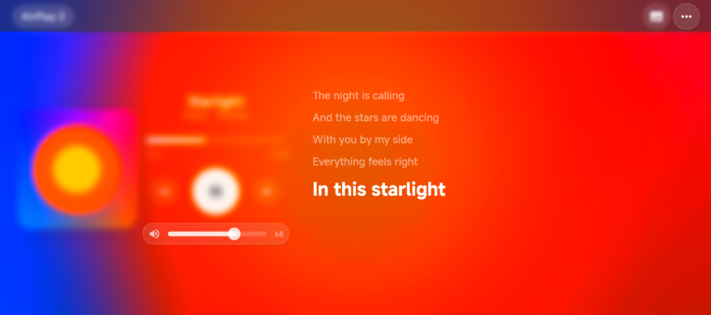
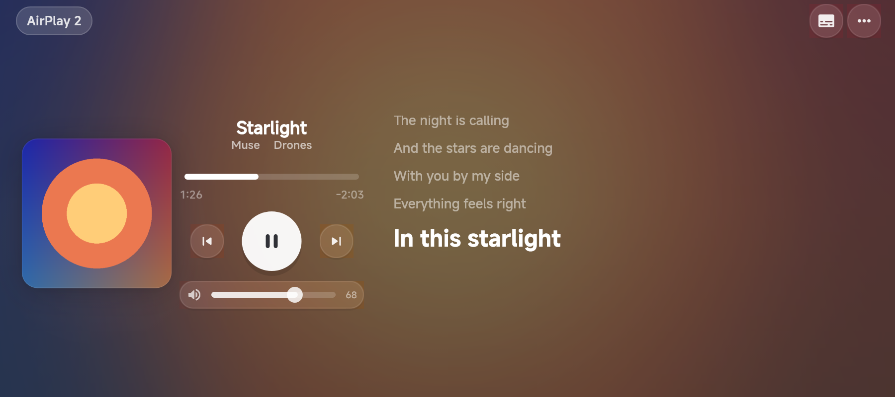
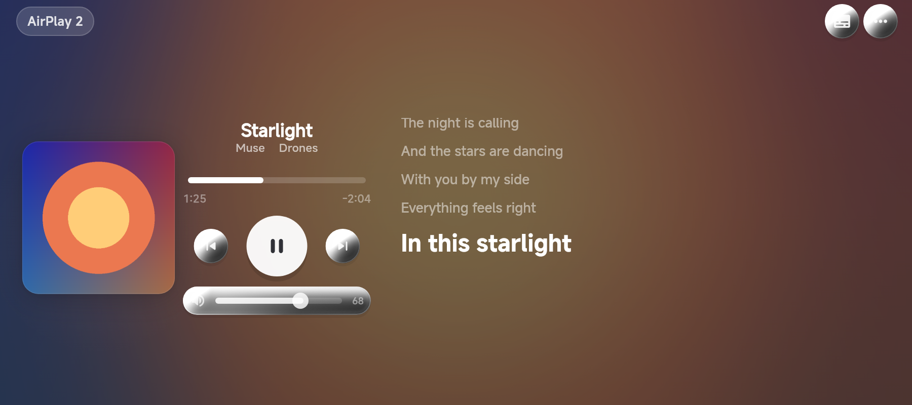
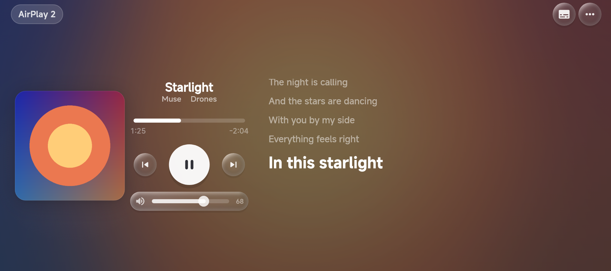
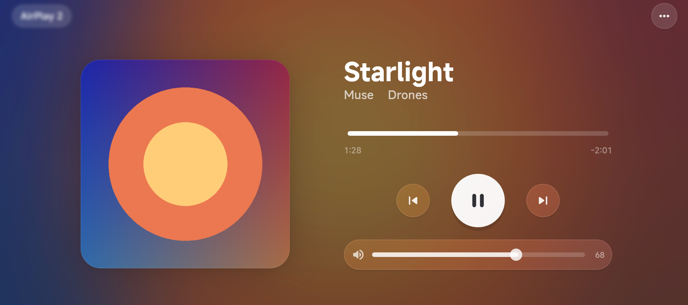
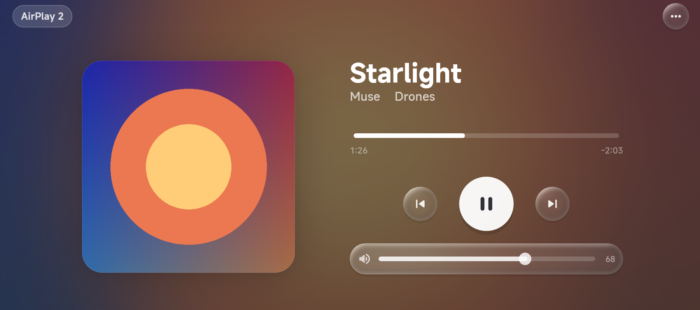
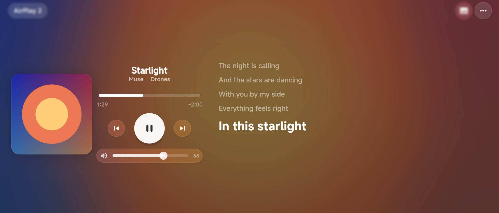
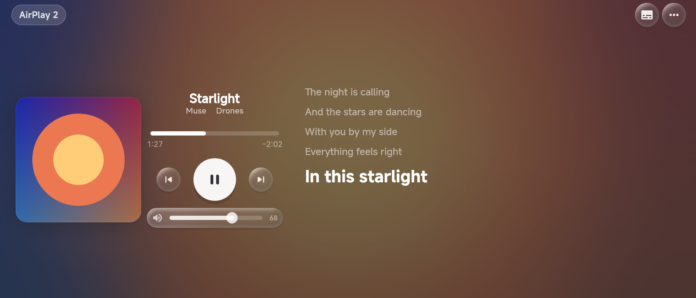
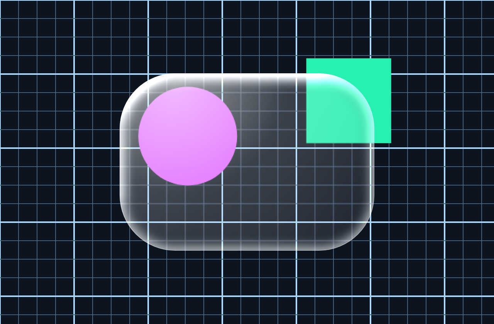
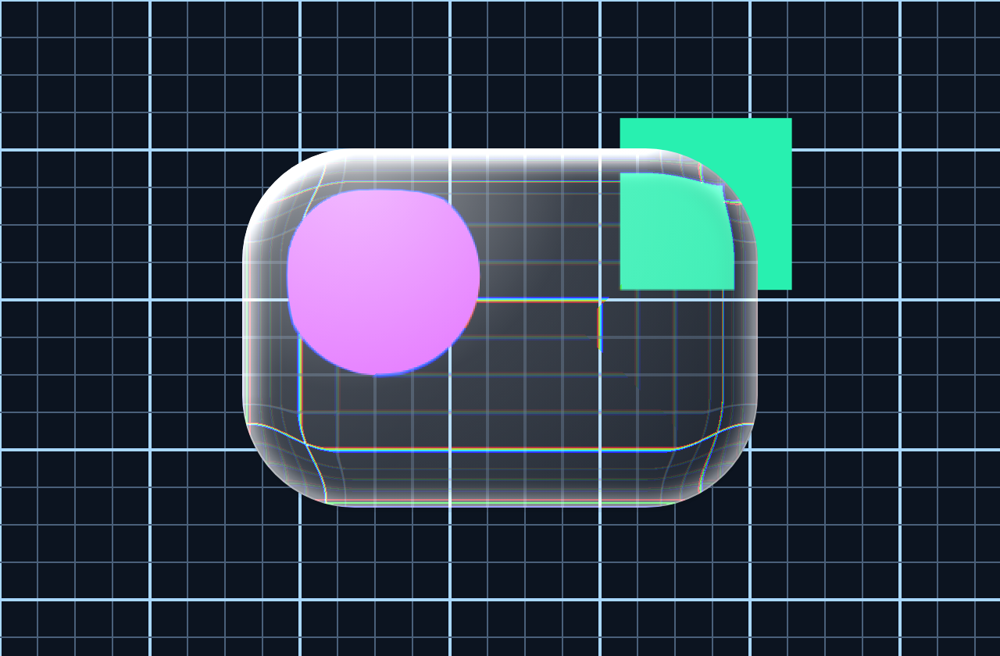

# 两轮基线与当前渲染

应用基线用 PR #2 的 e0d82b0，上一轮验收材料来自 main 的 aec10e2。以下图均为 Skia 软件渲染。诊断实验保留 round2 的截图宿主、预热顺序、封面、DPR 2 和原布局。最终图片来自修正后的宿主。原宿主重复绘制封面且用黑色 Scaffold 隔断背景，不能用不控制变量的最终图直接归因。

| 900×400 有歌词，左侧封面和顶部菜单 | 同一空白背景点 RGB，物理坐标 (900,680) |
|---|---|
|  | 复现原始故障。255,55,0 |
|  | 仅关闭 useOwnLayer。255,55,0 |
|  | 仅修改质量枚举。255,55,0 |
|  | 仅在 lightweight 的 pushLayer 外添加局部 pushClipRect。109,83,59 |
|  | 保留旧布局和旧采集器，换用本地采样器。109,83,59 |

最小实验：在 e0d82b0 检出工作树内，从 aec10e2 取出 fusionplay-ui-review-round2，复制该目录 tools 中的 Dart 测试到 flutter/test，然后运行播放器截图测试。第二次只应用本目录 tools/p01-clip-isolation.patch。保留 warmup → P01 → P02 → P03 的测试次序。两个实验均不需要修改布局、shader UV、封面图或歌词。丢失有效的控件范围裁切足以解释本次 Skia 的整层污染；此实验不涉及 Impeller。

| 场景 | 第二轮 | 本轮 |
|---|---|---|
| P01 有歌词 |  |  |
| P02 同尺寸无歌词 |  |  |
| P03 980×420 |  |  |

P01 封面由 150.7 增至 161.8，P03 由 159.1 增至 176.8。P01 进度控件仍高 40，时间框顶从 y=188 移至 185；轨道中心 y=178，通常线宽 6，轨道底到时间框顶为 4 逻辑像素。实际字形留白取决于字体。旧报告的约 10 px 是可见字形估值，不能直接等同于控件框距。

G01–G03 和 G08 分别来自同轮全图裁切；G04/G05 是不同动画时刻。G06/G07 为滚动前后设置面板。G09/G10 为 toast、关于材质样例；额外的 update 系列走真实 Navigator 路由。高对比网格中相同材质、相同位置、不同折射强度的结果如下。

| 折射关闭 | 折射开启 |
|---|---|
|  |  |

## 各尺寸封面复测

| 场景 | 尺寸 | 第二轮宽度 | 本轮宽度 |
|---|---|---:|---:|
| [P01](screenshots/player/P01.png) | 900x400 | 150.7 | 161.8 |
| [P02](screenshots/player/P02.png) | 900x400 | 273.7 | 273.7 |
| [P03](screenshots/player/P03.png) | 980x420 | 159.1 | 176.8 |
| [P04](screenshots/player/P04.png) | 980x420 | 288.9 | 288.9 |
| [P05](screenshots/player/P05.png) | 840x360 | 90.0 | 148.0 |
| [P06](screenshots/player/P06.png) | 840x360 | 230.5 | 230.5 |
| [P07](screenshots/player/P07.png) | 620x320 | 64.0 | 64.0 |
| [P08](screenshots/player/P08.png) | 620x320 | 198.3 | 198.3 |
| [P09](screenshots/player/P09.png) | 1280x800 | 432.1 | 225.7 |
| [P10](screenshots/player/P10.png) | 1280x800 | 382.3 | 382.3 |
| [P11](screenshots/player/P11.png) | 1920x1080 | 500.1 | 285.8 |
| [P12](screenshots/player/P12.png) | 1920x1080 | 382.3 | 382.3 |
| [P13](screenshots/player/P13.png) | 899x400 | 150.5 | 161.5 |
| [P14](screenshots/player/P14.png) | 900x349 | 79.0 | 161.8 |
| [P15](screenshots/player/P15.png) | 900x350 | 80.1 | 162.1 |
| [P16](screenshots/player/P16.png) | 900x460 | 158.3 | 162.3 |
| [P17](screenshots/player/P17.png) | 900x461 | 158.4 | 162.6 |
| [P18](screenshots/player/P18.png) | 980x420 | 159.5 | 178.0 |
| [P19](screenshots/player/P19.png) | 980x420 | 288.9 | 288.9 |
| [P20](screenshots/player/P20.png) | 980x420 | 159.1 | 176.7 |
