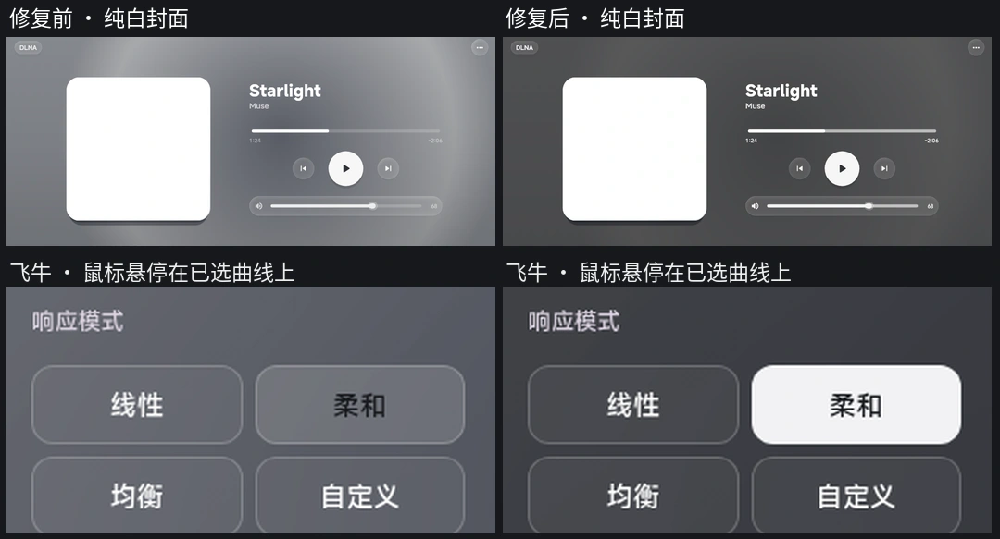

# FusionPlay 文字、图标与背景对比度复查

对照基线为统一分支的 `b6ea579`。测试使用纯白、纯黑、黑白分区和缺失封面，分别开启及关闭高级效果。上排展示纯白封面的共享播放器，下排展示飞牛网页中鼠标悬停在已选音量曲线上的状态。



| 实际渲染位置 | 条件 | 修改前 | 修改后 |
| --- | --- | ---: | ---: |
| 歌手 | 白封面，高级效果开启 | 3.44 | 8.07 |
| 剩余时间 | 同上 | 1.66 | 6.72 |
| 音量数值 | 同上 | 1.69 | 5.41 |
| 音量轨道未填充段与胶囊 | 同上 | 1.28 | 3.43 |
| 飞牛返回播放器 | 白封面，音箱列表 | 2.08 | 6.15 |
| 飞牛投送名称输入提示 | 白封面，新建实例 | 1.21 | 8.13 |
| 飞牛已选曲线悬停时的文字 | 黑封面，高级效果开启 | 1.49 | 15.75 |

表中单位为对比度比值。常规文字的回归门槛为 4.5，大标题、关键图形和轨道为 3。逐项结果含测试条件与门槛，修改前没有采样的单元格留空。[完整测量数据](measurements.csv)

## 界面与修复

- 共享播放器在模糊背景的亮部上施加限亮混合，深色通道保持原值；封面卡片在独立的图层上原色显示。歌手、时间、音量、来源标签和未填充轨道使用新的前景色。检查了上一曲、播放和下一曲的图标。未播放时使用浅色音符，封面缺失且有播放时使用深色音符，图片解码失败也显示占位图。[正常封面](player-photo.webp) · [空闲播放器](idle.webp)
- 滚动歌词和译文提高了辅助文字对比度，实时逐句推送的历史译文移除重复的透明度衰减。当前句继续用字号和字重强调。测量取视口内完整显示的歌词，滚动边缘保留渐隐效果。[浅色封面歌词](lyrics-light.webp) · [深色封面歌词](lyrics-dark.webp)
- 共用菜单、设置、更新、关于弹窗分别测了浅色文字；更新和关于的浅色主按钮另测深色文字。设置提示、次级文字及选项轮廓提高了可读性，工具提示明确指定前景和底色。[设置](settings-light.webp) · [获取更新](update-light.webp)
- 飞牛列表、新建、输出、曲线、更新页和移除确认框在 Chromium 中实测。已选曲线曾被通用悬停样式覆盖，现会保持浅底深字。图表会在系统强制配色切换时重绘，取实际画布元素的系统颜色。另模拟配置接口返回 503，确认设置失败提示可见，点击重试后能回到可编辑设置。[飞牛设置重试](nas-retry.webp)

## 复现与边界

Flutter 3.32.8 测试渲染器按 980 × 420、DPR 1 从真实界面截取像素。文字取字形内部靠近实色的笔画像素与邻近背景样本。图标取图形内部的亮暗像素，轨道在同一横坐标与上下相邻背景对照。使用全白、全黑封面时也检查了封面卡片中心的原色。Chromium 在同一位置先后截取正常文字和仅隐藏字形的画面；强制配色的曲线直接与隐藏画布时相同位置的背景比较。

从仓库根目录运行以下命令。飞牛图集与依赖准备见[跨平台图集](../platform-gallery/README.md)。

```sh
(cd flutter && FUSIONPLAY_CONTRAST_PREVIEW=/tmp/fusionplay-contrast flutter test test/surface_contrast_test.dart)
python3 fnos/tools/capture-platform-gallery.py --sdk-archive /tmp/fusionplay-trim-sdk.tgz --output /tmp/fusionplay-contrast --contrast-only
```

本次使用软件渲染与浏览器合成。测量覆盖上述界面、状态与背景，未测实体电视、Android 或 Windows 显示器的实际亮度、HDR 和系统显示缩放。
