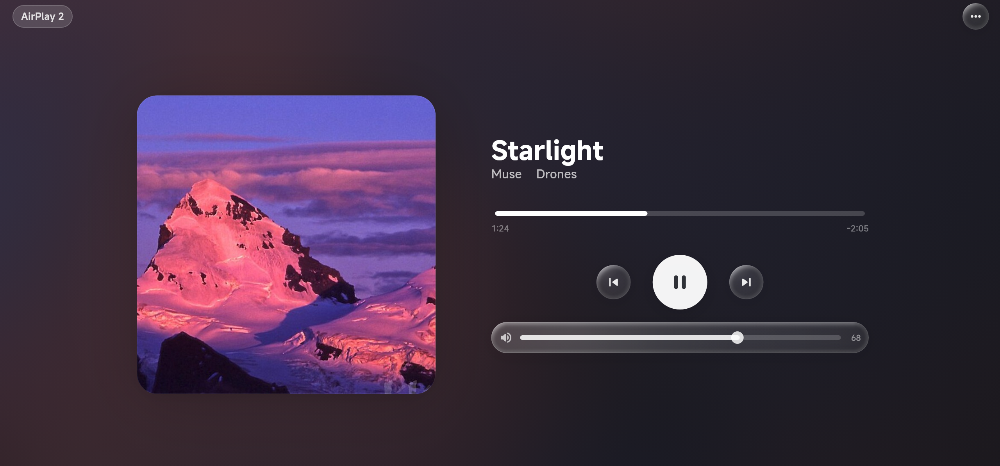
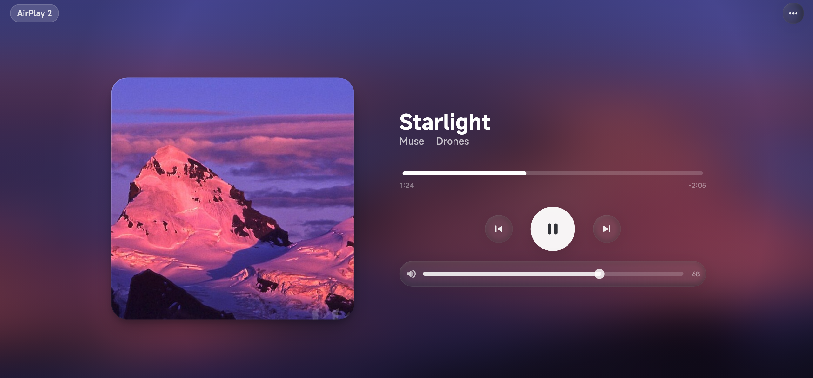
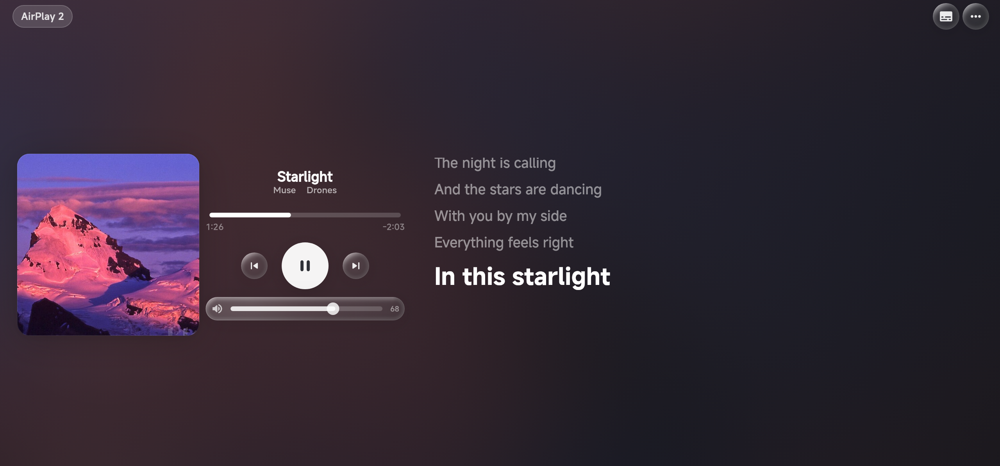
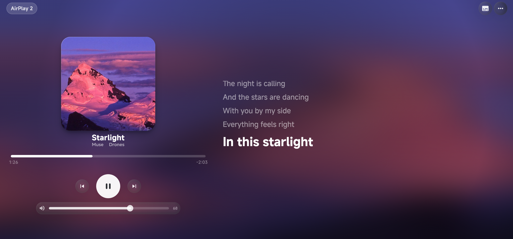
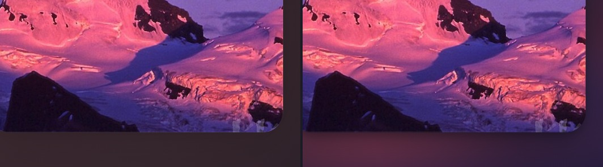
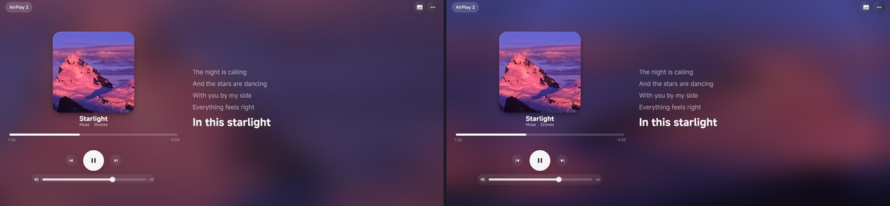

# 播放器封面与玻璃光照对照

两栏使用同一张照片、相同的 Flutter 3.32.8 / Skia 软件渲染环境、1280×597 逻辑尺寸、DPR 2、相同曲目和进度。左列基于 ea3bc78；右列为本次调整。截图使用生产播放器与背景组件，预先解码封面，显式开启真实的模糊阴影。Flutter Widget 测试默认禁用阴影模糊，会把悬浮效果误画成一块硬底板。

| 状态 | 调整前 | 调整后 |
|---|---|---|
| 无歌词 |  |  |
| 有歌词 |  |  |

封面下缘放大，左为调整前，右为调整后。



## 封面背景

下图左侧为 50ec4b8，右侧为本轮。两张图使用同一张雪山封面和相同的歌词状态。



PlayerBackdrop 接收与前景相同的封面源。背景把完整画面铺满视口并水平翻转，保留取自封面边缘的颜色。短边决定高斯模糊尺度，横向模糊稍宽；中央用局部暗色渐变给文字留出对比度。无歌词与有歌词共用此路径。白天的浅色封面和夜景封面会产生不同的背景色。关闭高级效果时仍使用原有的无模糊路径。

## 两个可借鉴的实现

| 方案与实际代码 | 在 FusionPlay 中采用的处理 |
|---|---|
| liquid_glass_renderer 1.0.0-dev.2。final_render_core 同时读取背景、几何纹理，在靠近轮廓处计算方向高光。高光目标颜色含透射面的颜色。此版要求 Flutter ≥3.47.0、Dart ≥3.13.0。 [源码包](https://pub.dev/packages/liquid_glass_renderer/versions/1.0.0-dev.2) | 在边缘沿法线偏移背景采样，将少量高光混入透射色。移除 painter 中常驻左上径向白斑、第二道模糊亮边和模拟焦散。指针进入或按压才启用局部反馈。 |
| fluid_glass 0.5.7。refraction.frag 用圆角矩形距离与梯度计算偏移，中心区域直接读取内容纹理。高光与色散有独立 shader。要求 Flutter ≥3.35.0、Dart ≥3.9.0。 [源码包](https://pub.dev/packages/fluid_glass/versions/0.5.7) | 平坦区域一次采样；只在有效折射边缘追加红、蓝通道的采样。保留现有共享背景与降级路径。 |

两个源码包均采用 Apache-2.0。此轮参考了光学处理思路，应用继续使用自己的 shader 和 Flutter 3.32.8，未增加依赖。第三方兼容性依据发布包的 SDK 约束判断；没有在本项目中运行这两个库。

## 封面悬浮

封面边缘使用一条 1.2 逻辑像素的渐变倒角。面内保留原图，下缘用较窄的遮蔽阴影交代厚度，外侧投影向下偏移约封面宽的 4.8%，限制在 5–16 逻辑像素。阴影使用负扩展，让深色集中在下方。取消旧的固定粉色环境光，背景改为透出更多原封面色彩。歌词区高度允许时，封面位于歌曲信息上方；矮屏保留并排布局。

## 复现

从 flutter 目录运行：

```bash
FUSIONPLAY_AUDIT=1 flutter test test/audit_capture_test.dart --plain-name 'photographic cover'
```

照片仅作审查素材。BrettA343 的 *Alpenglow on Mt. Forbes in the Canadian Rockies*，裁成方形并缩放；照片和预览中的照片衍生图像按 CC BY-SA 4.0 提供。[原始作品与作者](https://commons.wikimedia.org/wiki/File:Alpenglow_on_Mt._Forbes_in_the_Canadian_Rockies.jpg) · [许可](https://creativecommons.org/licenses/by-sa/4.0/)

本次全量测试通过 214 项。flutter analyze 返回 18 条既有的第三方弃用 info。Android Impeller 真机上的高光、颜色和阴影仍待验证。[测试日志](test.txt) · [分析器输出](analyze.txt)
