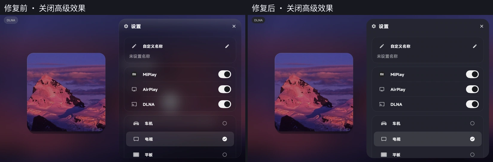
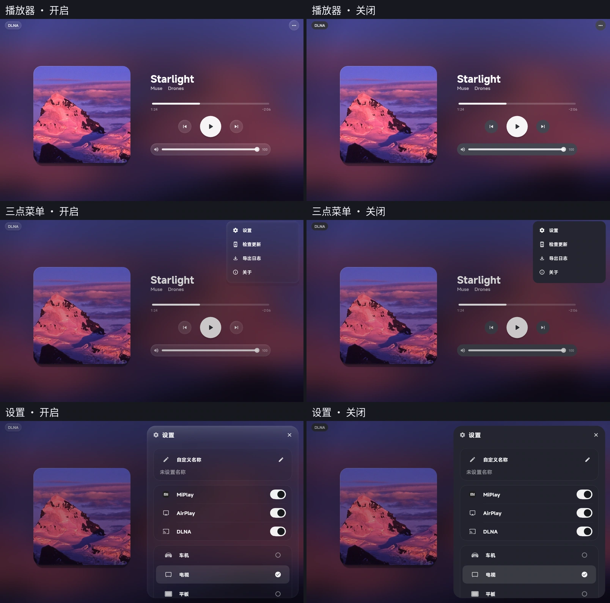
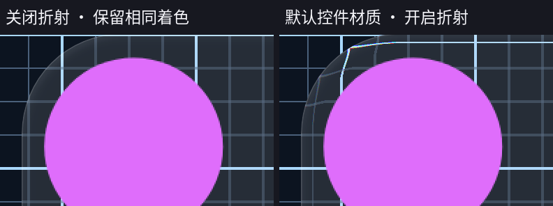
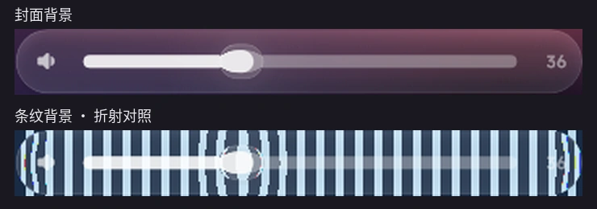

# 高级效果开关与设置透明度

两组截图来自 Flutter 3.32.8 Linux 测试渲染器。固定 1000 × 600 逻辑像素、DPR 1，同一张 alpenglow 封面和同一 DLNA 播放状态。通过应用的三点菜单进入设置。修复前使用统一分支提交 `48bfb3b`。



旧版关闭采集后进入 BackdropFilter 兼容路径，后面的播放键在面板中部留下亮斑。新版本在关闭时直接填充不透明面板。沿面板左边内侧 x=496，在 y=125、292、360、480 四处采样，关闭后均为 RGB(37,37,48)。开启时对应 RGB 分别为 (52,44,69)、(48,36,54)、(53,35,51)、(40,31,53)。



开启时，背景纹理负责形状相关的位移采样，着色和细边高光在其上绘制一次。Web 保留实时背景，并在菜单、设置及弹窗上使用局部模糊以保持文字可读。关闭时，封面背景继续作为播放器场景显示，控件与浮层使用实色。飞牛保留原有的默认开启状态，选择保存在访问该站点的浏览器内。



上图只改变折射强度，字形和边线的着色参数保持相同。左侧直边 14 个逻辑像素内，折射与零位移图的 RGB 通道平均绝对差为 7.31（满量程 255）。

从 `flutter/` 运行以下命令可生成六张原始 PNG。移除环境变量可只运行回归断言。

```sh
FUSIONPLAY_EFFECTS_PREVIEW=/tmp/fusionplay-effects flutter test test/effects_mode_test.dart
flutter test test/glass_optics_test.dart test/app_menu_test.dart
```

本次截图与高对比网格检测使用软件渲染。Android Impeller 真机表现及 GPU 帧耗时仍需设备复测。


## 跟手音量透镜



上行来自播放器的雪山封面背景，下行使用固定条纹检查采样位移。两行都在 900 × 400 的实际 PlayerView 中拖动音量，从 36% 移至 72% 后松手。图中裁出音量胶囊并放大两倍。[查看拖动中的播放器全图](volume-player.webp)

滑块在自己的坐标中用凸面计算背景采样位置，并在同一坐标重建轨道的圆端和宽度。这样可以同时放大轨道和背景，无需重新捕获含有滑块本身的画面。播放按钮、菜单和弹窗的玻璃共用局部按压折射，松开后在 150 毫秒内恢复。设置开关使用同款透镜，高级效果关闭时使用实色控件。飞牛网页音量曲线预览保留原生范围输入，移动的玻璃层通过浏览器位移滤镜采样下方轨道。

从 `flutter/` 执行 `FUSIONPLAY_LENS_PREVIEW=/tmp/volume-lens flutter test test/volume_droplet_test.dart test/glass_optics_test.dart` 生成两组 PNG。测试检查拖动前后两个位置的条纹位移、按压范围、释放还原和音量提交次数。独立网页的测试在 Chromium 中固定条纹、滑块着色和几何位置，仅切换位移滤镜对照像素。这里记录的是软件测试与浏览器结果，实体设备的帧时间和与 iOS 实物的对照仍待测。
