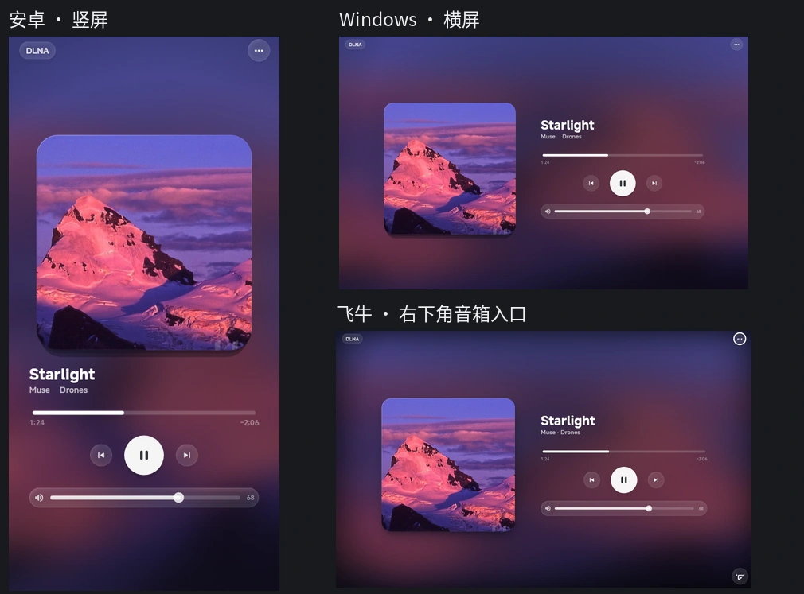
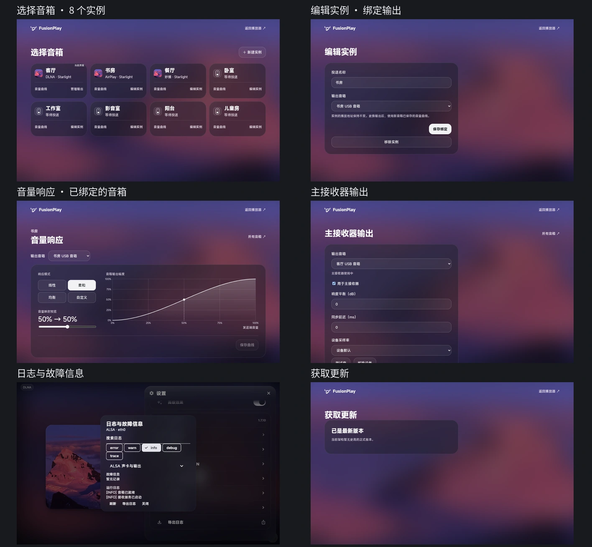
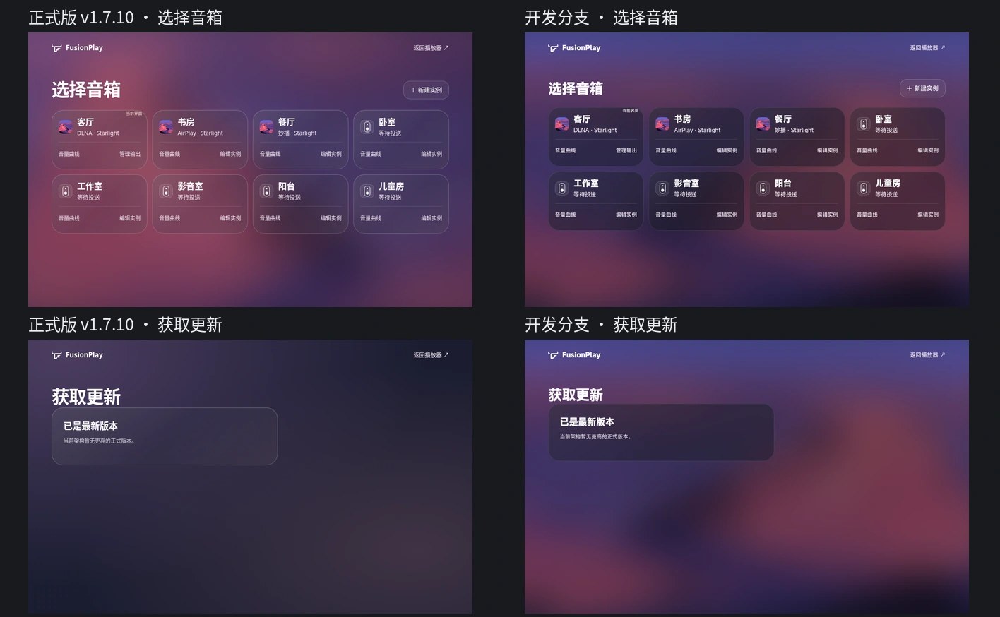

# FusionPlay 跨平台界面图集

以下是开发分支实际渲染的应用界面。各平台使用同一张雪山封面、同一首示例曲目，开启高级效果。Android 和 Windows 通过各自的更新能力进入共享 Flutter 页面，由 Linux 上的 Flutter 3.32.8 测试渲染器截图。飞牛使用 release 模式 Flutter Web 播放器与随包 HTML，在 Chromium 156 中截图。音箱、曲目、日志和更新响应来自本地测试数据。



| 页面 | Android · 410 × 840 | Windows · 1100 × 680 | 飞牛 Web · 1100 × 680 |
| --- | --- | --- | --- |
| 播放 | [竖屏](screenshots/android-player.webp) | [横屏](screenshots/windows-player.webp) | [横屏](screenshots/fnos-player.webp) · [有歌词](screenshots/fnos-lyrics.webp) |
| 菜单 | [三点菜单](screenshots/android-menu.webp) | [三点菜单](screenshots/windows-menu.webp) | [右下角音箱菜单](screenshots/fnos-speaker-menu.webp) |
| 设置 | [设置](screenshots/android-settings.webp) | [设置](screenshots/windows-settings.webp) | [共享设置面板](screenshots/fnos-settings.webp) |
| 获取更新 | [下载更新](screenshots/android-update.webp) | [选择保存目录](screenshots/windows-update.webp) | [当前架构的检查结果](screenshots/fnos-update.webp) |
| 信息弹窗 | [关于](screenshots/android-about.webp) | [关于](screenshots/windows-about.webp) | [日志与故障信息](screenshots/fnos-logs.webp) |

## 飞牛专属页面



| 功能 | 截图 |
| --- | --- |
| 选择音箱 | [八个实例](screenshots/fnos-rooms.webp) · [手机浏览器](screenshots/fnos-rooms-mobile.webp) |
| 绑定、改名与移除 | [新建](screenshots/fnos-new.webp) · [编辑](screenshots/fnos-edit.webp) · [移除确认](screenshots/fnos-confirm.webp) |
| 音量曲线 | [开启高级效果](screenshots/fnos-curve.webp) · [关闭高级效果](screenshots/fnos-curve-off.webp) · [手机浏览器](screenshots/fnos-curve-mobile.webp) |
| 主接收器 | [音频输出与校准](screenshots/fnos-outputs.webp) |
| 服务设置 | [网络接口](screenshots/fnos-network.webp) · [AirPlay 配对](screenshots/fnos-pairing.webp) · [日志与故障信息](screenshots/fnos-logs.webp) |

飞牛音箱页和更新页复用由 Flutter 主题导出的面板底色、模糊半径和实色底，字体来自同一个 MiSans 资源。网页通过浏览器的背景滤镜与圆角位移图采样，Flutter 使用自己的片元着色器。关闭高级效果后，音箱列表、新建、编辑、曲线、输出和更新页的卡片底色均为 RGB(37,37,48)，背景滤镜为 none。曲线继续独立显示输入与输出的映射。删除实例、移除设备配置和放弃曲线修改走网页玻璃对话框，取消后保留原状态。目录授权仍由飞牛系统处理。

## 与已发布版本对照



左列网页取自正式发布的 v1.7.10 x64 FPK。比对该版本 x64 和 ARM64 安装包的 app.tgz，两个包的 61 个 Web 文件路径和 SHA-256 逐一相同。开发分支也通过同一份 Flutter Web 产物与同一份静态文件清单构建两个 FPK。当前图集验证浏览器渲染，未在实体 NAS、Android Impeller 或 Windows 原生窗口上验收。

## 复现

仓库根目录执行以下命令。Python 截图工具使用 Playwright、Pillow 和 Chromium。SDK 使用飞牛打包脚本固定的 0.6.0 归档，工具在使用前验证 SHA-256。两条截图命令将原始 PNG 输出到同一目录。

```sh
(cd flutter && FUSIONPLAY_PLATFORM_PREVIEW=/tmp/fusionplay-gallery flutter test test/platform_gallery_test.dart)
(cd flutter && flutter build web --release --no-web-resources-cdn --pwa-strategy=none -t lib/backend/fnos/player.dart)
curl -fL https://registry.npmjs.org/@trimjs/web-app/-/web-app-0.6.0.tgz -o /tmp/fusionplay-trim-sdk.tgz
CHROMIUM=/usr/bin/chromium python3 fnos/tools/capture-platform-gallery.py --sdk-archive /tmp/fusionplay-trim-sdk.tgz --output /tmp/fusionplay-gallery
CHROMIUM=/usr/bin/chromium python3 fnos/tools/test-curve-page.py
python3 tools/sync_web_theme.py --check
```

Flutter 回归从实际菜单进入设置、更新和关于，检查窄屏设置行、竖屏封面与标题的间距，以及 Android 下载与 Windows 选目录的操作。浏览器回归包含小屏滚动、实例绑定、曲线保存、放弃与取消、弹窗焦点和实体底色检查。另在条纹背景上保持模糊和着色不变，单独切换位移滤镜，比对卡片边缘和中心的像素差。
