# FusionPlay UI 实机截图与液态玻璃验收报告

## 1. Git 与运行环境

- 仓库：https://github.com/youyoudezhuzhu/FusionPlay
- 验收分支：`ui/player-control-spacing-cover-20261118`
- PR：#2（Draft）`Refine landscape player layout and enable Impeller refractive glass`
- 提交：`f3916a5`（`Enable live refractive glass for settings_view.dart surfaces`）
- Flutter：3.32.8 stable / Dart 3.8.1
- 运行环境：Linux x86_64，`flutter_test`（VM，Skia 软件渲染）
- **未使用 Android 真机 / 未使用 Impeller**；所有截图为 Flutter Widget 测试渲染，不是实机截图
- 截图 DPR：2；PNG 物理尺寸 = 逻辑尺寸 × 2
- `liquid_glass_widgets`：vendored 0.18.4（MIT）

> 能力边界：当前 Agent 环境无 Android 设备、无 GPU、无法录屏，因此 Impeller 真机折射、帧率、Android 版本/GPU 均标注「未验证」。

## 2. 测试结果

执行：

```bash
cd flutter
flutter test test/player_preview_test.dart test/lyrics_player_test.dart
```

- 通过：36
- 失败：0
- RenderFlex overflow：无（P01–P12 均记录 `none`）
- 完整日志：`logs/flutter-test.log`

截图采集测试（额外）：

```bash
flutter test test/ui_review_capture_test.dart
```

- 通过：2，失败：0
- 日志：`logs/capture.log`

## 3. 截图索引

### 播放器主界面

| 编号 | 分辨率 | 状态 | 截图 |
|---|---|---|---|
| P01 | 900×400 | 有歌词 | 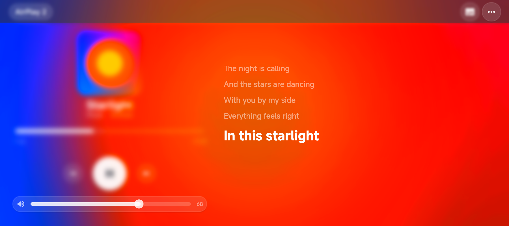 |
| P02 | 900×400 | 无歌词 | 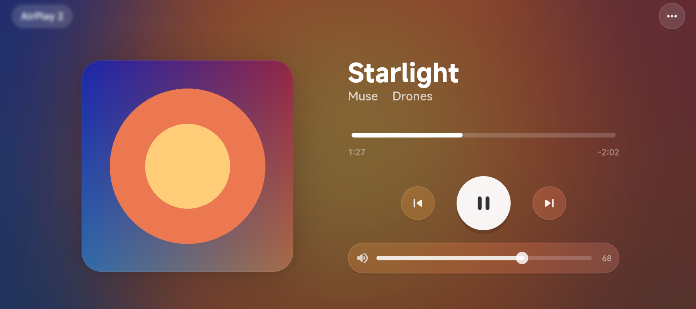 |
| P03 | 980×420 | 有歌词 | 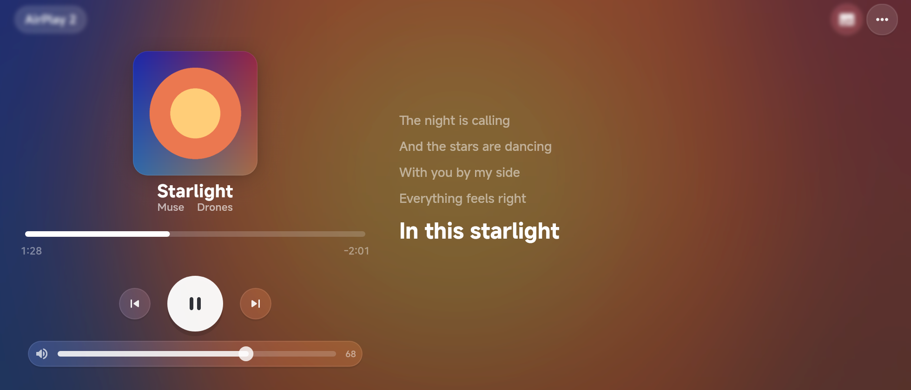 |
| P04 | 980×420 | 无歌词 | 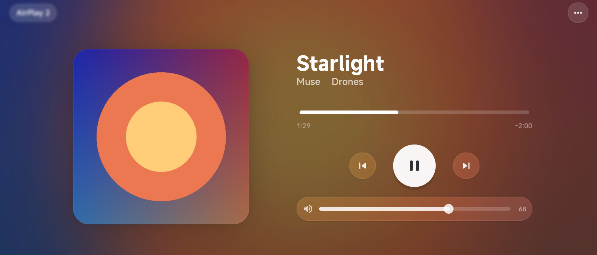 |
| P05 | 840×360 | 有歌词 | 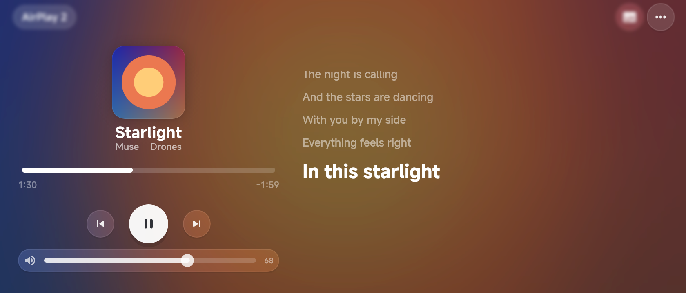 |
| P06 | 840×360 | 无歌词 | 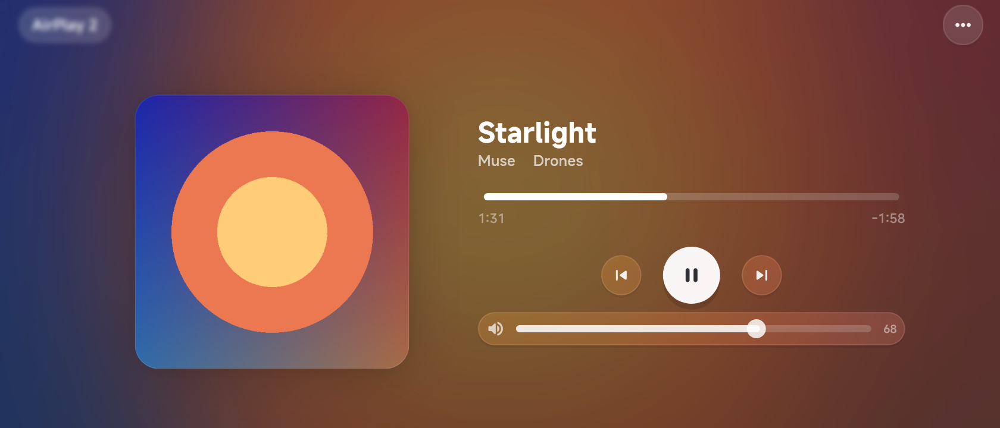 |
| P07 | 620×320 | 有歌词 | 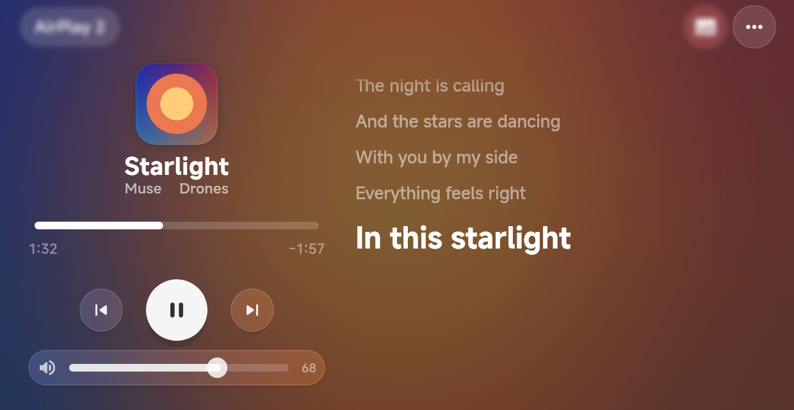 |
| P08 | 620×320 | 无歌词 | 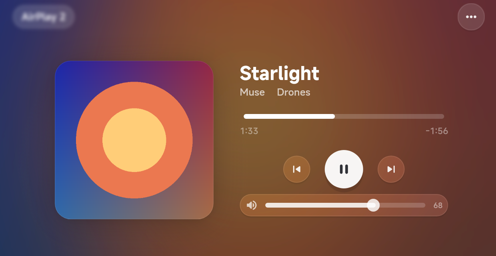 |
| P09 | 1280×800 | 有歌词 | 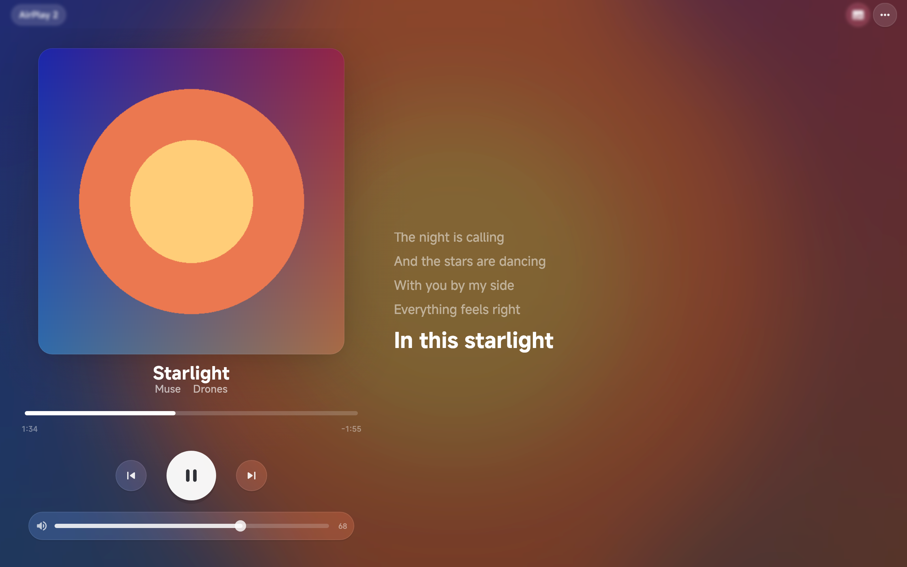 |
| P10 | 1280×800 | 无歌词 | 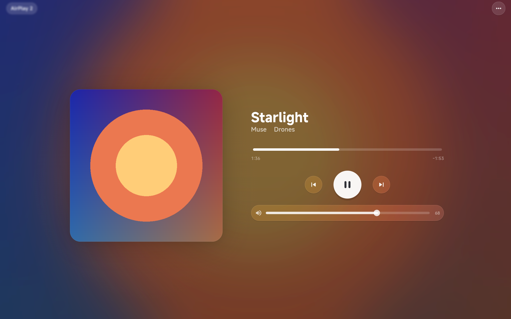 |
| P11 | 1920×1080 | 有歌词 | 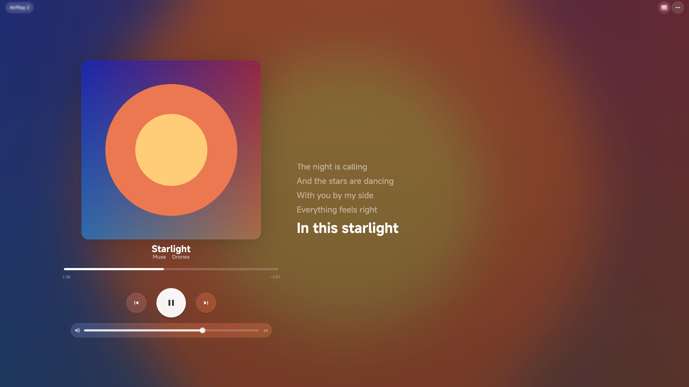 |
| P12 | 1920×1080 | 无歌词 | 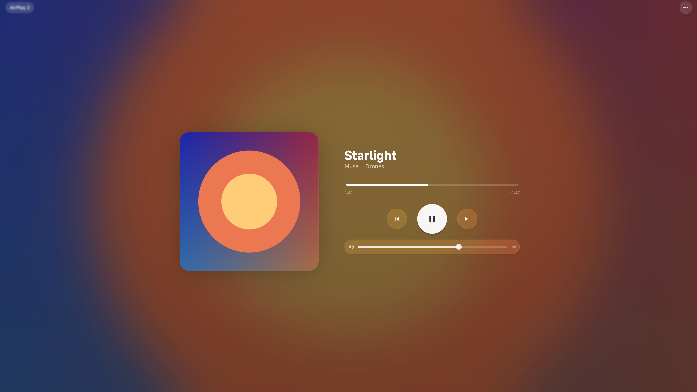 |

### 液态玻璃专项（980×420）

| 编号 | 场景 | 截图 |
|---|---|---|
| G01 | 上一曲 / 下一曲按钮 | 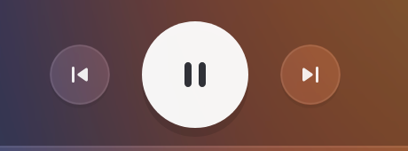 |
| G02 | 音量胶囊 | 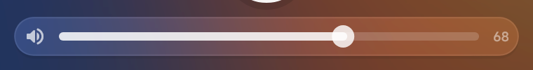 |
| G03 | 顶部歌词/菜单按钮 | 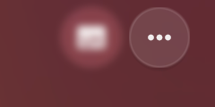 |
| G04 | 三点菜单完全展开 | 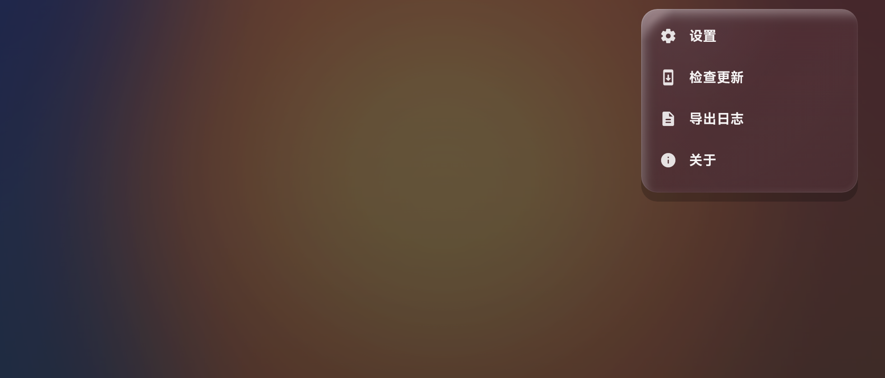 |
| G05 | 菜单展开中间帧 | 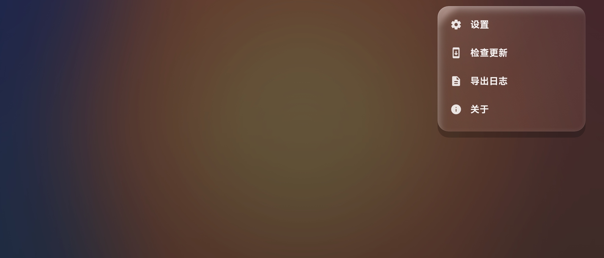 |
| G06 | 设置面板完全展开 | 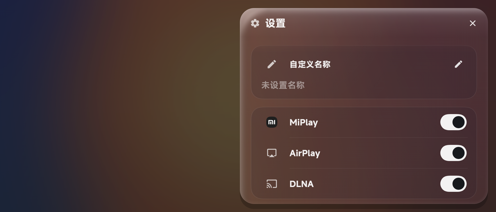 |
| G07 | 设置面板滚动后 | 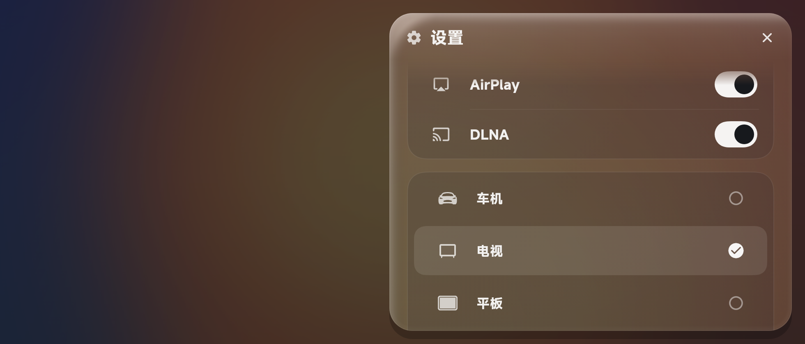 |
| G08 | 设置内部卡片 | 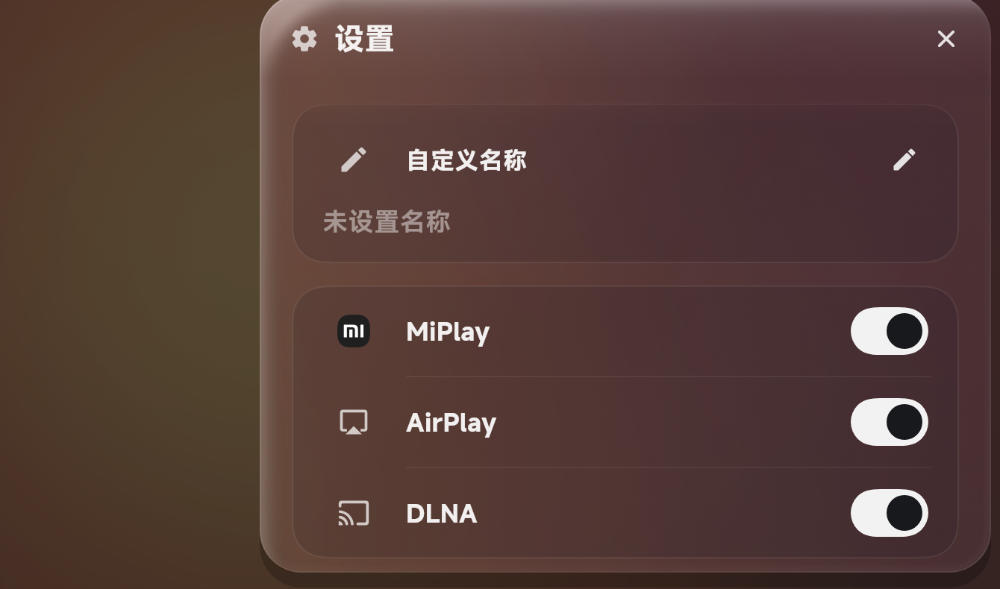 |
| G09 | 错误提示气泡 |  |
| G10 | 关于弹窗 | 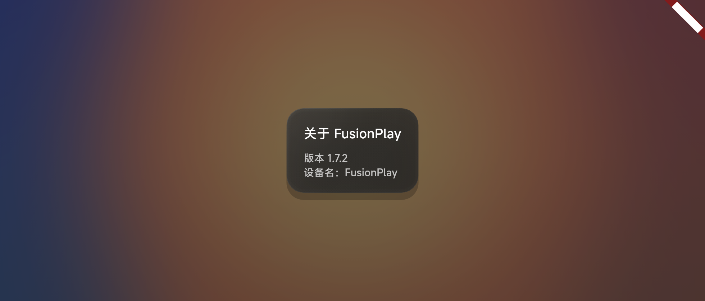 |

项目真实存在的弹窗：关于弹窗、更新可用/更新进度/更新提示、错误 toast、日志确认类对话框。本次实际截图覆盖关于弹窗与错误 toast；更新类弹窗需要模拟网络状态，未单独截图（**未验证**，不虚构）。

## 4. 布局测量

完整数据：`measurements.csv`。以下为 P01–P12 关键值（单位：逻辑像素，来自 Widget 布局矩形，不是截图像素采样）。

| id | size | overflow | dpr | physical_px | cover_w | cover_h | progress_top | time_top | time_bottom | play_center_y | volume_top | controls_height | play_centering_deviation_px | progress_to_time_gap_px |
|---|---|---|---|---|---|---|---|---|---|---|---|---|---|---|
| P01 | 900x400 | none | 2 | 1800x800 | 114.1 | 114.1 | 212.0 | 242.0 | 257.0 | 307.0 | 347.0 | 334.0 | 5.0 | -10.0 |
| P02 | 900x400 | none | 2 | 1800x800 | 273.7 | 273.7 | 155.0 | 189.0 | 204.0 | 263.0 | 314.0 |  | 4.0 | -6.0 |
| P03 | 980x420 | none | 2 | 1960x840 | 134.0 | 134.0 | 232.0 | 262.0 | 277.0 | 327.0 | 367.0 | 354.0 | 5.0 | -10.0 |
| P04 | 980x420 | none | 2 | 1960x840 | 288.9 | 288.9 | 165.0 | 199.0 | 214.0 | 273.0 | 324.0 |  | 4.0 | -6.0 |
| P05 | 840x360 | none | 2 | 1680x720 | 90.0 | 90.0 | 189.0 | 219.0 | 234.0 | 275.0 | 306.0 | 294.0 | 5.0 | -10.0 |
| P06 | 840x360 | none | 2 | 1680x720 | 230.5 | 230.5 | 145.5 | 175.5 | 190.5 | 231.5 | 262.5 |  | 5.0 | -10.0 |
| P07 | 620x320 | none | 2 | 1240x640 | 64.0 | 64.0 | 156.0 | 186.0 | 201.0 | 242.0 | 273.0 | 254.0 | 5.0 | -10.0 |
| P08 | 620x320 | none | 2 | 1240x640 | 198.3 | 198.3 | 125.5 | 155.5 | 170.5 | 211.5 | 242.5 |  | 5.0 | -10.0 |
| P09 | 1280x800 | none | 2 | 2560x1600 | 432.1 | 432.1 | 563.0 | 597.0 | 612.0 | 671.0 | 722.0 | 718.0 | 4.0 | -6.0 |
| P10 | 1280x800 | none | 2 | 2560x1600 | 382.3 | 382.3 | 355.0 | 389.0 | 404.0 | 463.0 | 514.0 |  | 4.0 | -6.0 |
| P11 | 1920x1080 | none | 2 | 3840x2160 | 500.1 | 500.1 | 731.0 | 765.0 | 780.0 | 845.0 | 902.0 | 998.0 | 4.0 | -6.0 |
| P12 | 1920x1080 | none | 2 | 3840x2160 | 382.3 | 382.3 | 489.0 | 523.0 | 538.0 | 603.0 | 660.0 |  | 4.0 | -6.0 |

说明：
- 播放按钮居中偏差 = 播放按钮中心 Y − (时间文字底部 Y + 音量胶囊顶部 Y) / 2；正值偏向音量胶囊，负值偏向进度条。
- 进度线到时间文字的「可见间距」不能用 Widget 矩形直接得出：进度控件包含 40px 触摸热区，且时间行有 `Transform.translate`，因此表中 `progress_to_time_gap_px` 为负值（-10 / -6），仅代表矩形关系；截图中实际可见间距约 6–10px，需要用像素采样才能精确，本次未做逐像素采样。

关键观察：
- 有歌词模式 900×400 封面仅 114×114，而目标图封面约占画面高度 40%（约 160px）。
- 无歌词模式 900×400 封面 274×274，视觉占比明显大于有歌词模式，两种状态不一致。
- P01–P08 播放按钮居中偏差大多为 +5px（偏向音量胶囊），并非严格居中。

## 5. 液态玻璃渲染路径分析

PR #2 的改动：
- 播放器上一曲/暂停/下一曲/音量胶囊：`GlassQuality.premium`、`useOwnLayer: true`、`chromaticAberration: 0.35`。
- `main.dart`、`app_menu.dart`、`settings_view.dart` 移除了 `forceFallback`，改为走真实折射路径（`LiquidGlass` + `GlassBackdropScope`）。

实际验证：
- 测试日志出现 `[LightweightGlass] ✓ Shader precached (native shared mode)`，说明 `liquid_glass_widgets` 在 Skia 下走的是 **lightweight shader 降级路径**，不是 Impeller premium。
- 项目自研 `LiquidGlass` 在测试里能通过 `GlassBackdropScope` 取到背景纹理，但截图显示 **P01 900×400 有歌词整块画面被模糊脏层覆盖**（见 P01），说明背景采样/合成在该尺寸下异常。
- 无法确认 Android Impeller 下 premium shader 是否编译、执行、采样实时背景；**未验证**。

## 6. 动态折射验证

- D02：同一播放器改到高对比网格背景：`screenshots/glass/D02-grid-980x420.png`。
- 边缘裁切：`screenshots/details/D03-cover-edge.png`、`screenshots/details/D03-grid-edge.png`。
- 对比结果：网格背景下没有观察到清晰的线条位移/折射偏移；玻璃主要表现为模糊+色调，边缘仅轻微高光。**不能证明动态折射已生效**。
- 菜单展开中间帧：G05；**未录屏**（环境无录屏能力，`recordings/` 为空并附说明）。
- Impeller vs Skia 对比：**未验证**（无 Impeller 环境）。

## 7. 问题清单

### P0

1. **P01 900×400 有歌词出现大面积模糊脏层/红色色块**
   - 位置：`flutter/lib/ui/player_view.dart`（播放器玻璃控件/背景采样）
   - 现象：封面、标题、进度条、按钮区域被整块模糊覆盖，右侧歌词正常；同分辨率无歌词正常，980×420 正常。
   - 影响：目标尺寸主界面不可用。
   - 建议：优先排查 premium + `useOwnLayer` 在 Skia/非 Impeller 下的 backdrop capture；加尺寸回归；若设备不支持 Impeller，明确降级而不是显示脏层。

2. **Android Impeller 真机折射未验证**
   - 位置：`flutter/lib/ui/player_view.dart`、`liquid_glass.dart`
   - 现象：所有截图来自 Skia widget test；premium 实际未执行。
   - 影响：不能宣称液态玻璃已通过验收。
   - 建议：真机 Profile 运行并抓取 G01/G02/edge 对比图。

### P1

3. **玻璃按钮仍偏平、偏棕，缺少目标图的轻薄透明感**
   - 位置：`player_view.dart` 中 `GlassContainer` 参数（thickness 9 / blur 2 / glassColor 0x0C-0x12FFFFFF）
   - 现象：G01/G02 中按钮与音量胶囊是半透明棕色圆片，没有明显边缘折射和高光变化。
   - 建议：在 Impeller 真机验证后再调；不要继续在 Skia 上盲调颜色。

4. **顶部 AirPlay 标签与歌词切换按钮发虚/出现白色糊块**
   - 位置：`player_view.dart` `_liquid21TopBar` + 顶部玻璃按钮
   - 现象：P03/P05 顶部左侧文字明显模糊，右上歌词按钮呈白色光斑。
   - 建议：检查玻璃层是否覆盖到非玻璃控件，或 backdrop 层叠顺序错误。

5. **有歌词模式封面偏小，与无歌词模式比例不一致**
   - 位置：`player_view.dart` `_liquid21Panel` 的 `controlsBudget = dense ? 204 : (compact ? 220 : 286)`
   - 数据：P01 封面 114px，P02 封面 274px；目标图有歌词/无歌词封面都约占高度 40%。
   - 建议：按实测控制区高度分配，不要用固定 budget 压缩有歌词封面。

6. **播放按钮略偏下（+5px）**
   - 数据：P01/P03/P05/P07 偏差 +5px。
   - 建议：调整 transport 上下间距，使偏差接近 0。

### P2

7. **无动态录屏与 Impeller/Skia 对比**
   - 原因：环境无录屏、无 Impeller 设备。
8. **更新类弹窗未截图**
   - 原因：需要模拟更新状态；仅验证关于弹窗与错误 toast。
9. **时间文字可见间距未做像素采样**
   - 现有数据为 Widget 矩形，进度控件含 40px 热区 + translate，无法代表视觉间距。

## 8. 验收结论

**未通过**（P0：900×400 有歌词渲染脏层；P0：Android Impeller 折射未验证）。

可交付部分：12 张主界面截图、10 张玻璃/弹窗截图、布局测量 CSV、两份测试日志。所有截图均来自实际 Flutter 代码渲染，未做修图。
